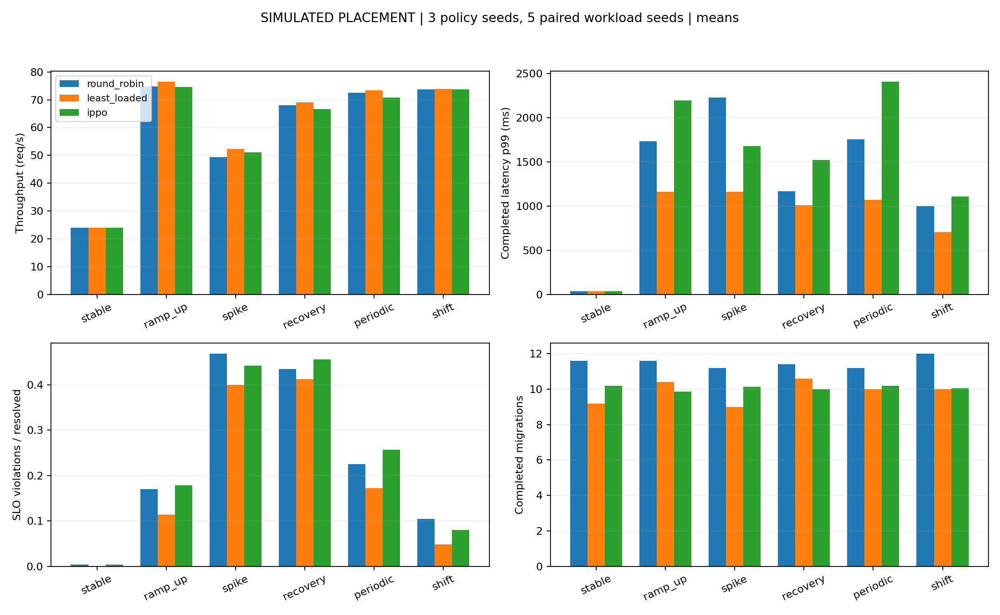
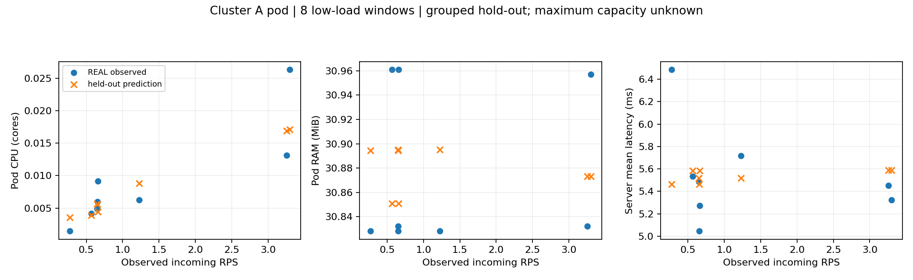
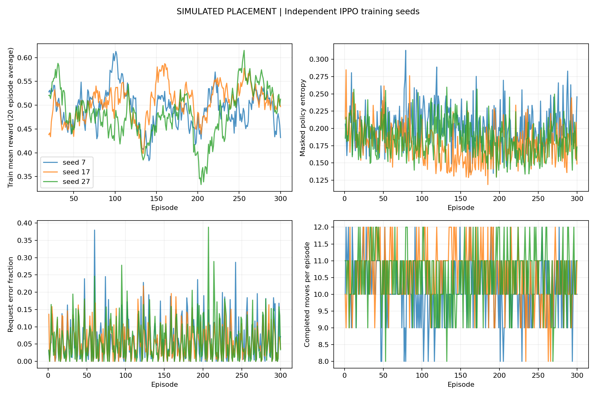

# Task 2 — Calibration, Placement V1 và closeout

Đây là báo cáo duy nhất cần đọc cho Task 2, gồm kết quả H1–H6, calibration, training/evaluation, shadow, kế hoạch thử tải và các phụ lục kỹ thuật. Không cần mở thêm báo cáo trong results.

## Kết quả và trạng thái hiện tại

- Run chính: `results/task2/placement_v1_20261109_03`; closeout: `results/task2/placement_v1_20261109_03_closeout`. Dữ liệu/checkpoint/CSV ở nguyên vị trí.
- Đã huấn luyện 3 policy seed × 300 episode và đánh giá 150 run ở giai đoạn Task 2 trước đây; không huấn luyện lại khi gom tài liệu. IPPO không vượt Least Loaded tổng thể.
- Calibration V1 chỉ low-load; CPU purged relative MAE 60,86%, saturation/capacity tối đa chưa xác định.
- **A1/A2/A3/A4/A6 DONE; A5 PENDING.** Cluster A đã được xác minh bằng snapshot REAL mới, ownerReferences/inventory/Metrics API đầy đủ và shadow replay 3 checkpoint. `closed_loop_ready=false`; B/C vẫn giả lập.
- 156 test cũ của Task 2 đã đạt ở lần nghiệm thu V1; bộ tổng hiện có 236 test đạt (gồm test V2, reward, preservation và A4), xem [Task 3](../task3/REPORT.md#validation). Đây là kết quả đã chạy trước, không phải lần test mới ở lượt gom tài liệu.

Phần closeout bên dưới là trạng thái hiện hành. Các phụ lục audit, proposal và báo cáo run cũ được đánh dấu lịch sử; thông báo SSH timeout/BLOCKED trong đó không thay thế cập nhật phục hồi mới. A5 chưa được duyệt và chưa chạy tải.

<a id="a4-fresh-completion"></a>

## A4 đã đóng — snapshot REAL và shadow replay mới

**A4 = DONE; A1/A2/A3/A4/A6 DONE, A5 PENDING.** Task 2B đã đủ bằng chứng nghiệm thu theo phạm vi closeout; kế hoạch A5 vẫn chờ phê duyệt riêng. Không đồng nghĩa controller sẵn sàng chạy closed-loop.

Snapshot được thu lúc **19:12:43 ngày 09/11/2026 (Asia/Saigon, UTC+7)**, tương ứng `2026-11-09T12:12:43.063793+00:00`. User `stack` chạy collector đã chuẩn bị; agent tải file và tự kiểm tra nội dung/UID/metrics, tính inventory và chạy shadow. Đây là dữ liệu REAL mới, thay thế việc chỉ dựa trên báo cáo thủ công. SHA-256 snapshot: `7f25edb35251078cae18cc098db5a1f10c44fea5f35600a71f466d78ddb597e7`.

| Checklist A4 | Bằng chứng đã xác minh |
|---|---|
| Node/namespace | k3s-a Ready, v1.37.2+k3s1; namespace cloud-calibration Active, có UID/timestamp |
| Identity | Deployment calibration-work → ReplicaSet calibration-work-66587db7cb → Pod calibration-work-66587db7cb-7w7dc; ownerReferences khớp UID, không suy từ prefix tên |
| Readiness phục vụ | Pod Ready và EndpointSlice targetRef trỏ đúng Pod UID, endpoint ready=true |
| Reservation cụm | GET toàn bộ 5 pod; 4 pod non-terminal được tính, 1 pod terminal loại; giữ requests/limits từng container và trạng thái cấp phát |
| Metrics API | Có node/pod metrics và timestamp/window; node age 20.064s, calibration pod age 22.064s tại clock capture, đều ≤30s |
| Schema/shadow V1 | Vector 123 feature, hash/schema/checkpoint code được kiểm; 3 checkpoint seeds 7/17/27 × 3 workload = 9 đề xuất KEEP; executable=false, 0 operations |
| Chỉ số tại snapshot | Giá trị |
|---|---:|
| CPU allocatable | 2 core |
| RAM allocatable | 1967.645 MiB |
| CPU node usage | 98.500m (4.925%) |
| RAM node usage | 1170.168 MiB (59.470%) |
| CPU reservation tất cả pod đang giữ chỗ | 250m (12,5% allocatable) |
| RAM reservation tất cả pod đang giữ chỗ | 172 MiB (8.741% allocatable) |
| Calibration requests/limits | requests 50m / 32Mi; limits 250m / 96Mi |

Không trộn các số mới với CPU 196m/RAM 1180Mi của lần báo cáo thủ công trước đó: đây là hai thời điểm đo khác nhau. Metrics fresh **tại thời điểm capture**, không phải telemetry streaming ở mọi thời điểm sau đó; shadow dùng capture clock, historical_only=true và không được dùng snapshot quá hạn để điều khiển thật.

Có thể lấy từ Kubernetes: capacity/allocatable, CPU/RAM usage, resource requests/limits, reservation suy ra từ inventory, identity/owner chain, Pod/endpoint Ready. Chưa đo trong A4: app queue/RPS/latency/error theo workflow, DAG bytes/dependency, RTT/bandwidth WAN, giá mạng, lifecycle/cooldown history của controller. Các dữ liệu này cần app/tracing/controller hoặc config/proxy; không gán 0 như đã đo. Mapping ở đây chỉ dành cho Sample API prototype, không chứng minh DAG V2 thật đã triển khai.

**closed_loop_ready=false**: B/C chưa có thật, app telemetry và mapping DAG V2 còn thiếu; KEEP-only shadow chứng minh interface/fallback, không chứng minh scheduling tối ưu. Không gửi /work, /health hoặc /metrics tới Sample API, không thử tải, không sửa key/sudoers/OpenStack, không thực thi migration.

Bằng chứng: [snapshot](../../results/task2/placement_v1_20261109_03_closeout/a4_fresh_20261109_03/snapshot.json), [inventory](../../results/task2/placement_v1_20261109_03_closeout/a4_fresh_20261109_03/analysis_verified/reservation_inventory.json), [readiness/checklist](../../results/task2/placement_v1_20261109_03_closeout/a4_fresh_20261109_03/analysis_verified/readiness.json), [shadow/feature availability](../../results/task2/placement_v1_20261109_03_closeout/a4_fresh_20261109_03/analysis_verified/shadow.json), [trạng thái hiện hành](A4_STATUS.json). Quy tắc init/sidecar/overhead và Pod-level requests đối chiếu [Kubernetes sidecars](https://kubernetes.io/docs/concepts/workloads/pods/sidecar-containers/) và [Pod-level resources](https://kubernetes.io/docs/tasks/configure-pod-container/assign-pod-level-resources/).

A5 vẫn PENDING tại [kế hoạch hiện hành](#a5-load-plan). Chưa có Locust run mới hoặc calibration profile V2; CPU error 60,86%/miền low-load của V1 chưa thay đổi. Cần duyệt rõ mức RPS, thời lượng, stop/recovery trước lượt tải riêng; profile mới phải kiểm chứng ngoài mẫu và không mặc định tốt hơn V1.

## Mục lục

- [H6 — Closeout và trạng thái A4 hiện hành](#closeout)
- [Kết quả Placement V1](#placement-results)
- [Kế hoạch A5 — PENDING, chưa phát tải](#a5-load-plan)

<details>
<summary>Mục lục phụ lục kỹ thuật và lịch sử</summary>

- [API đọc kết quả](#source-docs-api-md)
- [Kiến trúc simulator ban đầu](#source-docs-architecture-md)
- [Thiết kế thí nghiệm và tái hiện](#source-docs-experiments-md)
- [MARL và reward ở mô hình nền](#source-docs-marl-md)
- [Cấu trúc dự án trước khi gom tài liệu](#source-docs-project-layout-md)
- [Bàn giao nền A–F](#source-docs-reports-af-delivery-md)
- [Kiểm chứng nền A–F](#source-docs-reports-af-validation-md)
- [Lịch sử sắp xếp dự án](#source-docs-reports-cleanup-md)
- [Kế hoạch thử tải cũ — đã được thay bởi mục A5](#source-docs-task2-controlled-load-test-plan-md)
- [Audit môi trường ban đầu](#source-docs-task2-environment-audit-md)
- [H1 — Audit mã nguồn và checkpoint](#source-docs-task2-h1-code-audit-md)
- [H2 — Calibration và sai số ngoài mẫu](#source-docs-task2-h2-calibration-report-md)
- [H3 — Cài đặt Placement V1](#source-docs-task2-h3-implementation-report-md)
- [H4 — Huấn luyện và đánh giá Placement V1](#source-docs-task2-h4-training-evaluation-report-md)
- [H5 — Offline shadow và readiness tại lần chạy trước](#source-docs-task2-h5-sim-to-real-readiness-md)
- [Thiết kế Placement V1 đã triển khai](#source-docs-task2-placement-design-proposal-md)
- [Mục lục Task 2 trước khi gom](#source-docs-task2-readme-md)
- [Kết quả nền — heuristic simulator cũ](#source-results-baseline-report-md)
- [Kết quả nền — đánh giá routing cũ](#source-results-evaluation-report-md)
- [Run Task 2 _01 — đã được thay thế](#source-results-task2-placement-v1-20261109-01-superseded-md)
- [Run Task 2 _02 — đã được thay thế](#source-results-task2-placement-v1-20261109-02-superseded-md)
- [Closeout — bản ghi lịch sử tại thời điểm chạy](#source-results-task2-placement-v1-20261109-03-closeout-report-md)
- [Cluster A phục hồi — bản ghi thủ công](#source-results-task2-placement-v1-20261109-03-closeout-manual-recovery-20261109-01-report-md)
- [Kết quả nền — huấn luyện routing cũ](#source-results-training-report-md)

</details>

Chỉ cần file này. Bản gốc trước khi gom nằm trong [ZIP lưu trữ](../archive/reports_before_consolidation_20261109_01.zip), kèm hash để đối chiếu.

<a id="closeout"></a>

## H6 — Closeout và trạng thái A4 hiện hành

### H6 Đóng các thiếu sót Task 2B

**A4 DONE: đã có snapshot REAL và shadow replay mới. Task 2B đã đủ bằng chứng closeout; A5 tiếp tục PENDING kế hoạch thử tải riêng.**

| Hạng mục | Trạng thái | Kết quả |
|---|---|---|
| A1 | DONE | Phân tích đủ 6 scenario, policy/workload SD và paired differences từ run gốc |
| A2 | DONE | Tái tạo telemetry tài nguyên 150 run, xác minh summary khớp; không bịa trường bị thiếu |
| A3 | DONE | 3 checkpoint, CPU 1 thread, warmup 100, 1000 mẫu, mean/p95/p99 |
| A4 | DONE | Snapshot REAL UTC, UID/owner chain, inventory toàn cụm, node/pod Metrics API và 3-policy shadow đã xác minh |
| A5 | PENDING | Chỉ có kế hoạch yêu cầu phê duyệt bằng văn bản; không phát tải thật |
| A6 | DONE | Phân biệt reward/randomization V1 với phần bổ sung V2/Task 4 |

#### A1 Kết quả theo scenario

Số là mean từng run; SD policy được tính sau mean qua workload, SD workload sau mean qua policy. Không xem 15 run IPPO là 15 policy seed độc lập.

| Scenario | Method | Throughput ± SD policy / workload | P99 ms ± SD policy / workload | SLA resolved ± SD policy / workload |
|---|---|---|---|---|
| periodic | round_robin | 72.5600 ± N/A / 0.7094 | 1754.5600 ± N/A / 441.4224 | 0.2249 ± N/A / 0.0299 |
| periodic | least_loaded | 73.4533 ± N/A / 1.9694 | 1068.7800 ± N/A / 603.9700 | 0.1719 ± N/A / 0.0718 |
| periodic | ippo | 70.8607 ± 0.8498 / 1.5712 | 2405.8667 ± 499.1876 / 1004.5043 | 0.2571 ± 0.0305 / 0.0587 |

periodic, IPPO − round_robin: throughput -1.6993 req/s; p99 +651.3067 ms; SLA +0.0322. Throughput dương tốt hơn; latency/SLA âm tốt hơn. Không quy thành một người thắng mọi mục tiêu.

periodic, IPPO − least_loaded: throughput -2.5926 req/s; p99 +1337.0867 ms; SLA +0.0852. Throughput dương tốt hơn; latency/SLA âm tốt hơn. Không quy thành một người thắng mọi mục tiêu.

| ramp_up | round_robin | 74.7378 ± N/A / 2.8371 | 1731.2400 ± N/A / 1055.4132 | 0.1697 ± N/A / 0.0838 |
| ramp_up | least_loaded | 76.4067 ± N/A / 1.3969 | 1161.9000 ± N/A / 466.4237 | 0.1139 ± N/A / 0.0239 |
| ramp_up | ippo | 74.5789 ± 1.6905 / 2.2477 | 2198.0667 ± 1054.4823 / 578.3716 | 0.1785 ± 0.0552 / 0.0472 |

ramp_up, IPPO − round_robin: throughput -0.1589 req/s; p99 +466.8267 ms; SLA +0.0089. Throughput dương tốt hơn; latency/SLA âm tốt hơn. Không quy thành một người thắng mọi mục tiêu.

ramp_up, IPPO − least_loaded: throughput -1.8278 req/s; p99 +1036.1667 ms; SLA +0.0647. Throughput dương tốt hơn; latency/SLA âm tốt hơn. Không quy thành một người thắng mọi mục tiêu.

| recovery | round_robin | 68.0100 ± N/A / 1.0688 | 1166.6800 ± N/A / 395.5244 | 0.4351 ± N/A / 0.0347 |
| recovery | least_loaded | 69.1289 ± N/A / 0.5290 | 1010.6600 ± N/A / 378.7451 | 0.4124 ± N/A / 0.0232 |
| recovery | ippo | 66.7226 ± 2.0550 / 2.2260 | 1522.6800 ± 407.7395 / 560.2586 | 0.4563 ± 0.0274 / 0.0315 |

recovery, IPPO − round_robin: throughput -1.2874 req/s; p99 +356.0000 ms; SLA +0.0212. Throughput dương tốt hơn; latency/SLA âm tốt hơn. Không quy thành một người thắng mọi mục tiêu.

recovery, IPPO − least_loaded: throughput -2.4063 req/s; p99 +512.0200 ms; SLA +0.0438. Throughput dương tốt hơn; latency/SLA âm tốt hơn. Không quy thành một người thắng mọi mục tiêu.

| shift | round_robin | 73.7256 ± N/A / 1.1275 | 1000.0200 ± N/A / 491.8217 | 0.1045 ± N/A / 0.0683 |
| shift | least_loaded | 73.9189 ± N/A / 1.2492 | 707.9400 ± N/A / 1273.7185 | 0.0487 ± N/A / 0.0581 |
| shift | ippo | 73.7611 ± 1.1489 / 1.0256 | 1109.9733 ± 762.1261 / 446.0805 | 0.0803 ± 0.0413 / 0.0275 |

shift, IPPO − round_robin: throughput +0.0356 req/s; p99 +109.9533 ms; SLA -0.0242. Throughput dương tốt hơn; latency/SLA âm tốt hơn. Không quy thành một người thắng mọi mục tiêu.

shift, IPPO − least_loaded: throughput -0.1578 req/s; p99 +402.0333 ms; SLA +0.0316. Throughput dương tốt hơn; latency/SLA âm tốt hơn. Không quy thành một người thắng mọi mục tiêu.

| spike | round_robin | 49.2856 ± N/A / 3.7765 | 2231.1000 ± N/A / 869.4323 | 0.4683 ± N/A / 0.0742 |
| spike | least_loaded | 52.3556 ± N/A / 1.6490 | 1162.2000 ± N/A / 445.6883 | 0.3995 ± N/A / 0.0672 |
| spike | ippo | 51.1181 ± 0.8341 / 2.1373 | 1681.8267 ± 446.7367 / 408.1394 | 0.4426 ± 0.0200 / 0.0460 |

spike, IPPO − round_robin: throughput +1.8326 req/s; p99 -549.2733 ms; SLA -0.0257. Throughput dương tốt hơn; latency/SLA âm tốt hơn. Không quy thành một người thắng mọi mục tiêu.

spike, IPPO − least_loaded: throughput -1.2374 req/s; p99 +519.6267 ms; SLA +0.0431. Throughput dương tốt hơn; latency/SLA âm tốt hơn. Không quy thành một người thắng mọi mục tiêu.

| stable | round_robin | 23.9878 ± N/A / 0.4830 | 37.7800 ± N/A / 0.1789 | 0.0040 ± N/A / 0.0089 |
| stable | least_loaded | 24.0544 ± N/A / 0.3418 | 37.7200 ± N/A / 0.1924 | 0.0012 ± N/A / 0.0026 |
| stable | ippo | 23.9889 ± 0.0195 / 0.4806 | 37.7133 ± 0.0945 / 0.1820 | 0.0040 ± 0.0008 / 0.0088 |

stable, IPPO − round_robin: throughput +0.0011 req/s; p99 -0.0667 ms; SLA -0.0000. Throughput dương tốt hơn; latency/SLA âm tốt hơn. Không quy thành một người thắng mọi mục tiêu.

stable, IPPO − least_loaded: throughput -0.0656 req/s; p99 -0.0067 ms; SLA +0.0028. Throughput dương tốt hơn; latency/SLA âm tốt hơn. Không quy thành một người thắng mọi mục tiêu.

#### A2 Cân bằng tài nguyên

File timeseries gốc chỉ có arrival/processed/errors/waiting/placements, không có CPU/RAM. Vì vậy không thể tính đúng các std yêu cầu chỉ từ file đó. Closeout replay frozen V1 để ghi `offline/resource_timeseries_reconstructed.csv`; mọi summary gốc khớp trong 1e-9. Không huấn luyện hoặc sửa file gốc.

| Method | CPU usage std | RAM usage std | CPU reservation std | RAM reservation std | CPU mean | RAM mean | Waste |
|---|---:|---:|---:|---:|---:|---:|---:|
| round_robin | 0.177752 | 0.062582 | 0.102535 | 0.128169 | 0.528023 | 0.305491 | 0.381419 |
| least_loaded | 0.129023 | 0.060231 | 0.099083 | 0.123853 | 0.526926 | 0.299507 | 0.357060 |
| ippo | 0.181311 | 0.060748 | 0.099236 | 0.124045 | 0.522047 | 0.301541 | 0.368799 |

#### A3 Thời gian inference

| Policy seed | Mean ms | P95 ms | P99 ms |
|---|---:|---:|---:|
| 7 | 1.5659 | 2.5586 | 4.7292 |
| 17 | 1.3123 | 1.8850 | 2.8848 |
| 27 | 1.2143 | 1.7958 | 3.1852 |

Đây là benchmark local CPU, không phải latency controller/live Kubernetes; tải máy có thể ảnh hưởng tail. Cấu hình máy và phạm vi đo ở `offline/inference.json`.

#### A4 và A5

A4 DONE. Xem [bằng chứng thu mới và kết quả kiểm tra](#a4-fresh-completion) ở đầu báo cáo. A5 vẫn PENDING, không chạy tải hoặc tạo profile mới. [Kế hoạch A5](#a5-load-plan).

#### A6 Phần đã có và còn thiếu

V1 đã có success, latency/SLO, error, SLO violation, resource waste, migration/overlap cost, failed moves; randomization CPU factor, background CPU, network factor, readiness và faults. V1 actor nhìn toàn bộ 123 features, chưa phải actor local/critic global CTDE.

V2 bổ sung DAG, bốn mục tiêu gồm cân bằng CPU/RAM, traffic bytes/cost theo cạnh, ma trận RTT/bandwidth, CPU/RAM capacity randomization, bandwidth jitter, và schema tách actor/critic. Các miền randomization vẫn ASSUMPTION(SIMULATED), chưa được xác minh thực nghiệm. MAPPO/MADDPG/QMIX training, GA/Single-Agent RL/K8s-default-like benchmarks và nhiều controlled DAG đồng thời để Task 4/5.

Calibration vẫn profile V1 low-load, CPU purged relative MAE 60,86%; maximum capacity null. Không có profile mới vì A5 chưa được duyệt/chạy.

#### Bằng chứng và tái hiện

[Closeout artifacts](../../results/task2/placement_v1_20261109_03_closeout), source `src/cli/task2b.py`; `python -m cli.task2b --output <thư mục mới>` tạo stage offline mới và từ chối ghi đè. Seed/trace/config/code fingerprints, runtime freeze, JUnit được lưu cùng run.

#### Diễn giải A1 theo paired mean

Các nhận xét sau so với baseline trong cùng scenario/trace; chưa phải kết luận có ý nghĩa thống kê.

- periodic, IPPO so với round_robin: throughput kém hơn, p99 kém hơn, SLA kém hơn.

- periodic, IPPO so với least_loaded: throughput kém hơn, p99 kém hơn, SLA kém hơn.

- ramp_up, IPPO so với round_robin: throughput kém hơn, p99 kém hơn, SLA kém hơn.

- ramp_up, IPPO so với least_loaded: throughput kém hơn, p99 kém hơn, SLA kém hơn.

- recovery, IPPO so với round_robin: throughput kém hơn, p99 kém hơn, SLA kém hơn.

- recovery, IPPO so với least_loaded: throughput kém hơn, p99 kém hơn, SLA kém hơn.

- shift, IPPO so với round_robin: throughput tốt hơn, p99 kém hơn, SLA tốt hơn.

- shift, IPPO so với least_loaded: throughput kém hơn, p99 kém hơn, SLA kém hơn.

- spike, IPPO so với round_robin: throughput tốt hơn, p99 tốt hơn, SLA tốt hơn.

- spike, IPPO so với least_loaded: throughput kém hơn, p99 kém hơn, SLA kém hơn.

- stable, IPPO so với round_robin: throughput tốt hơn, p99 tốt hơn, SLA tốt hơn.

- stable, IPPO so với least_loaded: throughput kém hơn, p99 tốt hơn, SLA kém hơn.

Kiểm toán cuối: 232 file gốc khớp hash; xem `closeout_audit.json`. `junit.xml` là bản sao bộ regression thực 206 test (156 cũ + 50 V2); A4 hiện DONE sau kiểm tra snapshot fresh và shadow replay mới; xem phần đóng A4 ở đầu báo cáo. Kết quả kiểm toán/JUnit nêu trên là lần nghiệm thu trước, không phải lần chạy mới.

<a id="placement-results"></a>

## Kết quả Placement V1

### Task 2 Kết quả calibration và placement IPPO

Đã thực hiện PHẦN 0 và H1–H5 theo phạm vi cục bộ/offline shadow được người dùng phê duyệt. Có simulator placement riêng, calibration profile, ba policy seeds mới, 150 lượt đánh giá và báo cáo sim-to-real. **Chưa có bằng chứng capacity tối đa hoặc closed-loop deployment readiness. CPU calibration chưa đủ ổn định để khẳng định accuracy ngoài miền low-load.**

#### Những gì đã hoàn thành

| Hạng mục | Kết quả | Bằng chứng |
|---|---|---|
| H1 audit | routing v1 được phân biệt khỏi placement | [H1](#source-docs-task2-h1-code-audit-md) |
| H2 calibration | raw replay khớp, 8 windows, temporal holdout và simulator replay | [H2](#source-docs-task2-h2-calibration-report-md) |
| H3 implementation | 3 workload agents, 123 features, KEEP/MOVE, validator/lifecycle/masks | [H3](#source-docs-task2-h3-implementation-report-md) |
| H4 training | 3 seeds × 300 episodes, 30 traces, 150 evaluation runs | [H4](#source-docs-task2-h4-training-evaluation-report-md) |
| H5 shadow | version checks/negative cases, 3-policy archived replay, no writes | [H5](#source-docs-task2-h5-sim-to-real-readiness-md) |
| Tests | 156 passed | [JUnit](evidence/task2-tests-final.xml) |

#### Kết quả cần đọc trước

RAM/latency low-load có response profile và error estimates; CPU temporal-purged relative MAE 60.86% cho thấy dữ liệu còn yếu. Maximum capacity vẫn `null`, không extrapolate từ CPU thấp. Xem [calibration](../../results/task2/placement_v1_20261109_03/calibration/calibration.json), [purged validation](../../results/task2/placement_v1_20261109_03/calibration/purged_validation.json), [profile](../../results/task2/placement_v1_20261109_03/calibration/profile.json).

So sánh sau đây là **SIMULATED placement**, không phải đo live OpenStack/AWS:

| Thuật toán | Throughput req/s | Mean ms | P95 ms | P99 ms | Error % | SLO violation % | Completed moves |
|---|---:|---:|---:|---:|---:|---:|---:|
| round_robin | 60.384 | 157.00 | 780.48 | 1320.23 | 5.508 | 23.440 | 11.500 |
| least_loaded | 61.553 | 105.90 | 479.61 | 858.20 | 3.688 | 19.127 | 9.867 |
| ippo | 60.172 | 170.11 | 886.38 | 1492.69 | 5.613 | 23.645 | 10.078 |

IPPO không thắng Least Loaded tổng thể; báo cáo giữ đủ seed/scenario. Các percentile là mean của từng run; xem [CSV đầy đủ](../../results/task2/placement_v1_20261109_03/evaluation/comparison.csv) để đọc riêng biến thiên policy/workload seeds và [paired differences](../../results/task2/placement_v1_20261109_03/evaluation/paired_differences.csv).



#### Kiểm tra sản phẩm

- [Config](../../results/task2/placement_v1_20261109_03/placement_config.json), [schema](../../results/task2/placement_v1_20261109_03/schema.json), [provenance](../../results/task2/placement_v1_20261109_03/provenance.json), [runtime](../../results/task2/placement_v1_20261109_03/runtime.json), [freeze](../../results/task2/placement_v1_20261109_03/runtime-freeze.txt).

- [Training manifest](../../results/task2/placement_v1_20261109_03/training/manifest.json), checkpoints [seed 7](../../results/task2/placement_v1_20261109_03/training/seed_7/best.pt), [seed 17](../../results/task2/placement_v1_20261109_03/training/seed_17/best.pt), [seed 27](../../results/task2/placement_v1_20261109_03/training/seed_27/best.pt); từng thư mục còn có last.pt/training.csv/validation.csv.

- [Evaluation metadata](../../results/task2/placement_v1_20261109_03/evaluation/metadata.json), [per-run summary](../../results/task2/placement_v1_20261109_03/evaluation/summary.csv), [events](../../results/task2/placement_v1_20261109_03/evaluation/events.csv), [timeseries](../../results/task2/placement_v1_20261109_03/evaluation/timeseries.csv), [latency histograms](../../results/task2/placement_v1_20261109_03/evaluation/latency_histogram.csv).

- [Shadow matrix](../../results/task2/placement_v1_20261109_03/shadow-matrix.json), [readiness](../../results/task2/placement_v1_20261109_03/shadow/readiness.json), [safety/preservation verification](../../results/task2/placement_v1_20261109_03/verification.json).

- [Mã simulator](../../src/placement), [CLI](../../src/cli/task2.py), [tests](../../tests/placement/test_placement.py).

#### Chạy lại

Từ workspace, dùng output mới để giữ nguyên mọi kết quả cũ:

```powershell

.\.venv-task2\Scripts\python.exe -m cli.task2 --output results/task2/my_new_run

.\.venv-task2\Scripts\python.exe docs/task2/purged_validation.py --run results/task2/my_new_run

.\.venv\Scripts\python.exe -m pytest -q

```

CLI `--stage` cho phép calibrate/train/evaluate/shadow/plots riêng, mỗi stage từ chối ghi đè thư mục kết quả đã tồn tại. Runtime mới có thể dựng offline bằng [bootstrap_runtime.py](bootstrap_runtime.py) khi các dependencies gốc hiện diện; [requirements/task2.txt](../../requirements/task2.txt) liệt kê top-level dependencies để dựng trên máy khác. Model loader kiểm tra implementation fingerprint nên sửa physics/reward/schema cần run/checkpoint mới.

#### Giới hạn còn lại

Cập nhật hiện hành: Cluster A đã có snapshot REAL và shadow replay mới, A4 DONE; B/C vẫn chưa triển khai. Xem phần closeout trong báo cáo này. H5 chỉ logic/offline shadow, `closed_loop_ready=false`; không có operation thực thi. Chưa có external-run calibration, saturated-load data hoặc kiểm chứng CPU fit ổn định. Có [kế hoạch thu dữ liệu bổ sung](#source-docs-task2-controlled-load-test-plan-md), chưa chạy tải thật.

Các draft `_01`/`_02` được giữ với `SUPERSEDED.md`; **run chính thức để kiểm tra là `placement_v1_20261109_03`**. Dataset, checkpoint routing và kết quả gốc không bị sửa hoặc ghi đè.

<a id="a5-load-plan"></a>

## Kế hoạch A5 — PENDING, chưa phát tải

### A5 — Yêu cầu phê duyệt thử tải có kiểm soát

**PENDING — chỉ lập kế hoạch, chưa chạy tải, chưa có profile v2.** Phê duyệt phải nêu rõ `docs/task2/REPORT.md`, mục **Kế hoạch A5** trong file này và các mức RPS được phép, bằng văn bản ở một lượt riêng. Phản hồi chung chung không phải phê duyệt. Không thay đổi cấu hình hạ tầng.

#### Phạm vi và trình tự đề xuất

Chỉ Sample API trong namespace `cloud-calibration`, sau khi A4 xác minh sống identity Deployment/Pod, requests/limits, reservation toàn cụm và Metrics API. B/C không tham gia. Nếu identity, đồng hồ hay telemetry chưa hợp lệ thì không bắt đầu.

| Bước | Mức tải tổng tới Sample API | Thời lượng | Lặp |
|---|---:|---:|---:|
| Baseline không tải chủ động | 0 RPS | 120 giây | trước mỗi vòng |
| Warm-up | 0,5 RPS | 180 giây (3 phút) | mỗi vòng |
| Bậc 1 | 0,5 RPS | 120 giây | 3 vòng độc lập |
| Bậc 2 | 1 RPS | 120 giây | 3 vòng độc lập |
| Bậc 3 | 2 RPS | 120 giây | 3 vòng độc lập |
| Bậc 4 | 3 RPS | 120 giây | 3 vòng độc lập |
| Bậc 5, cần duyệt riêng mức này | 4 RPS | 120 giây | 3 vòng độc lập |
| Cool-down | 0 RPS chủ động | ít nhất 120 giây | sau mỗi vòng |

RPS ở bảng là tổng của toàn bộ worker, không nhân theo số worker. `/work` giữ payload tham chiếu `cpu_ms=5`, `memory_kib=64`, tối đa 2 request đồng thời như run cũ. Không tự tăng payload hoặc tải vượt mức duyệt để tìm saturation. Mức 4 RPS vượt miền dữ liệu cũ, có thể bị loại khỏi phê duyệt. Việc không thấy điểm gãy ở các mức này không chứng minh capacity tối đa.

Endpoint duy nhất được phép: `/health` trước/sau mỗi vòng và kiểm tra thưa tối đa 1 lần/10 giây, `/work` theo RPS được duyệt, `/metrics` thu mỗi 5 giây. Không gọi endpoint quản trị; không write Kubernetes/OpenStack API. Nếu đường dẫn/tham số thực tế khác thì phải xác minh trước lượt chạy.

#### Đồng bộ và điều kiện dừng

Locust và Collector dùng UTC, lưu clock offset trước/sau; độ lệch tuyệt đối >1 giây thì chưa chạy hoặc dừng thu và đánh dấu không hợp lệ. Collector bắt đầu trước baseline 60 giây, ghi pod UID, restart count, timestamps, interval/window của Metrics API và client request ID; kết thúc sau cool-down 60 giây. Ghi run ID mới, marker từng bậc và request thành công/thất bại/unfinished; không sửa run cũ. Không cộng số invocation để tính workflow arrivals.

Dừng toàn bộ tải ngay khi một trong các điều kiện sau xảy ra:

- Error/timeout >1% trong cửa sổ 30 giây có ít nhất 30 request; hoặc 3 lỗi liên tiếp khi tải nhỏ.
- CPU pod ≥90% limit liên tục 15 giây; CPU throttling tăng mạnh; restart/OOM mới hoặc pod mất Ready.
- Node `MemoryPressure`, RAM available <15%, hoặc CPU node ≥90% trong 15 giây.
- p99 `/work` >250 ms trong hai cửa sổ 30 giây, hoặc health thất bại 3 lần liên tiếp.
- Metrics mất >15 giây, đồng hồ lệch >1 giây, mất liên lạc, OpenStack API/VM có dấu hiệu suy giảm hay người vận hành yêu cầu dừng.

Ngưỡng trên là **ASSUMPTION** cho kế hoạch bảo thủ, cần đối chiếu baseline/limit A4 trước khi duyệt; không phải kết quả đo. Theo dõi OpenStack qua kiểm tra chỉ đọc sẵn có, không tạo VM hay tài nguyên để thử.

#### Phục hồi và đầu ra sau lượt được duyệt

Ngừng Locust trước, giữ Collector/health thưa để xác nhận trở về baseline ít nhất 120 giây. Không restart, scale, đổi request/limit hoặc can thiệp DevStack/K3s. Nếu chưa hồi phục thì dừng thí nghiệm và báo người vận hành; không tự sửa hạ tầng. Lưu cả run bị dừng và lý do.

Sau lượt thực tế được duyệt: fit profile có version mới ở thư mục mới, kiểm chứng fit run cũ → run mới và fit run mới → run cũ, tránh window chồng lấn. Báo CPU MAE/relative MAE (mốc cũ 60,86%), RAM, quan hệ RPS–latency và error. Chỉ ghi ngưỡng saturation khi quan sát điểm gãy có bằng chứng; nếu không, `maximum_capacity_rps=null`. Profile V1 giữ nguyên.

<a id="source-docs-api-md"></a>

## API đọc kết quả

<details>
<summary>Mở nội dung lưu theo lịch sử — trạng thái hiện tại nằm ở đầu báo cáo</summary>

### Tích hợp dashboard qua FastAPI (F)

API chỉ đọc CSV/metadata được simulator sinh ra; không khởi chạy huấn luyện, không giữ cloud credentials, không tạo hoặc thay đổi tài nguyên thật. Chưa sửa website React vì source website không có trong workspace.

#### Khởi động

```powershell

.\.venv\Scripts\python.exe -m cli.serve

### Hoặc đọc baseline A+B

.\.venv\Scripts\python.exe -m cli.serve --results results --port 8001

### Tương đương, dùng biến môi trường

$env:CLOUD_SIM_RESULTS = (Resolve-Path results/evaluation).Path

.\.venv\Scripts\python.exe -m uvicorn cloud_api.app:app --host 127.0.0.1 --port 8000

```

Mặc định dùng `results/evaluation`, host loopback, port 8000. OpenAPI/Swagger: `http://127.0.0.1:8000/docs`; schema: `/openapi.json`. Chỉ gọi GET, không có endpoint ghi hoặc điều khiển hạ tầng. Chạy pipeline xong trước khi serve dataset; nên dùng mỗi thư mục output cho một thí nghiệm riêng.

#### Hợp đồng dữ liệu

Tất cả response thành công có:

```json

{

  "data_source": "simulation",

  "is_simulation": true,

  "metrics_are_real": false,

  "notice": "Synthetic simulator output; not real OpenStack/Kubernetes/AWS telemetry."

}

```

Frontend phải giữ badge **Simulation** và không ghép các metric này vào thẻ telemetry OpenStack thật. Metric không có mẫu hoàn tất dùng JSON null. CPU/RAM là %, latency ms, throughput req/s, queue/processed/dropped là số request. Tất cả số CSV được chuyển về JSON numeric, không trả số dạng string. Lỗi trả HTTP 404/422/503 với `detail`, không sinh dữ liệu giả.

| Endpoint | Query | Nội dung |
|---|---|---|
| GET `/api/simulation/status` | không | ready/status, datasets, policies, scenarios, seeds, timestamp và checkpoint episode |
| GET `/api/simulation/clusters` | policy, seed, scenario | cấu hình A/B/C, effective capacity, CPU/RAM, max queue và metric cuối của bộ lọc |
| GET `/api/simulation/metrics` | policy, seed, scenario, cluster, dataset, start_second, end_second, limit, offset | time-series theo cluster hoặc toàn hệ thống, total và phân trang |
| GET `/api/simulation/comparison` | policy, scenario | mean/std và số mẫu cho mọi chỉ số trong comparison.csv |

`policy`: round_robin/least_loaded/marl; `scenario`: mixed/stable/ramp_up/spike/recovery. `dataset=cluster` mặc định hoặc `system`; system không nhận cluster filter. Giới hạn `limit` 1–10000 (mặc định 1000); `offset` và seed/thời gian không âm; end_second bao gồm mốc cuối và không được nhỏ hơn start_second. Không có bộ lọc → metrics trả tất cả trong phạm vi phân trang, vì vậy frontend nên chỉ định scenario/seed/policy.

Clusters mặc định lấy MARL nếu có, nếu không lấy policy đầu; seed đầu và scenario mixed (hoặc scenario đầu). Bộ lọc không có mẫu trả `latest_metrics=null` hoặc rows rỗng, không lấy metric từ một seed khác. Status là no_results/invalid_results/incomplete/ready; chỉ ready khi có đủ các dataset yêu cầu và metadata được đánh dấu simulation hợp lệ.

```powershell

Invoke-RestMethod 'http://127.0.0.1:8000/api/simulation/status'

Invoke-RestMethod 'http://127.0.0.1:8000/api/simulation/clusters?policy=marl&scenario=mixed&seed=30001'

Invoke-RestMethod 'http://127.0.0.1:8000/api/simulation/metrics?policy=marl&scenario=mixed&seed=30001&cluster=A&limit=180'

Invoke-RestMethod 'http://127.0.0.1:8000/api/simulation/metrics?dataset=system&policy=marl&scenario=mixed&seed=30001'

Invoke-RestMethod 'http://127.0.0.1:8000/api/simulation/comparison?scenario=mixed'

```

#### React tích hợp sau

Chỉ bật CORS cho đúng origin dashboard, ví dụ:

```powershell

$env:CLOUD_SIM_CORS_ORIGINS = 'http://localhost:5173,http://127.0.0.1:5173'

.\.venv\Scripts\python.exe -m cli.serve

```

Không bật wildcard credentials. Các origin trong ví dụ chỉ là cấu hình local tùy chọn; thay bằng origin website thật. React có thể dùng:

```javascript

const response = await fetch(

  'http://127.0.0.1:8000/api/simulation/metrics?dataset=system&policy=marl&scenario=mixed&seed=30001'

);

if (!response.ok) throw new Error(`Simulation API: ${response.status}`);

const payload = await response.json();

if (payload.data_source !== 'simulation') throw new Error('Unexpected data source');

// Hiển thị badge Simulation; dùng payload.rows để vẽ biểu đồ.

```

API độc lập với simulator/trainer; startup không import PyTorch hoặc load checkpoint. Muốn chuyển dataset, khởi động lại với `--results` hoặc biến môi trường khác.

</details>

<a id="source-docs-architecture-md"></a>

## Kiến trúc simulator ban đầu

<details>
<summary>Mở nội dung lưu theo lịch sử — trạng thái hiện tại nằm ở đầu báo cáo</summary>

### Kiến trúc simulator và hệ thống A → F

`python -m cli.baselines` → load JSON → tạo workload một lần cho mỗi seed → chạy riêng hai dispatcher trên các cluster mới → tổng hợp CSV/report → Matplotlib PNG. Simulator và policy chỉ dùng thư viện chuẩn; Matplotlib phục vụ biểu đồ và pytest phục vụ test. Lõi mô phỏng không kết nối mạng; collector G được tách riêng và không thay transition/training.

#### Trách nhiệm module

`config` định nghĩa dataclass bất biến và validation. `workload` dùng `random.Random(seed)` riêng, không làm thay đổi RNG toàn cục. `model.Cluster` giữ FIFO và cung cấp `observe/step`. `policies.Dispatcher` giữ trạng thái của thuật toán. `engine.simulate` tạo trạng thái mới cho mỗi run, kiểm tra hạch toán mỗi tick và toàn run. `experiments` ghép thí nghiệm công bằng. `storage` và `plotting` tách khỏi logic mô hình.

Sau này có thể thay nguồn `Observation` bằng adapter đo đạc thực, nhưng phải tách nhãn dữ liệu và hiệu chỉnh mô hình. Không đưa SDK OpenStack hoặc hành động hạ tầng thật vào `Cluster.step`.

#### Giới hạn tài nguyên

Tick cố định 1 giây; cấu hình năng lực là request/s:

```text

cpu_capacity = cpu_cores * requests_per_core

memory_slots = floor((memory_mb - idle_memory_mb) / memory_per_request_mb)

service_capacity = min(capacity, floor(cpu_capacity), memory_slots)

max_queue = min(queue_limit, memory_slots - service_capacity)

```

Phải phục vụ được ít nhất một request/tick; config không hợp lệ bị từ chối, không âm thầm sửa. `max_queue` là backlog sau service; RAM luôn dành trước một service batch đầy đủ. Đây là giới hạn bảo thủ khi service batch không đầy.

Cho `Q` là backlog đầu giây, `A` là số assigned, `C` là service capacity, `K` là max_queue:

```text

accepted = min(A, C + K - Q)

dropped = A - accepted

processed = min(C, Q + accepted)

queue_after = Q + accepted - processed

Q + A = processed + dropped + queue_after

```

RAM đỉnh trước service gồm memory nền + `(processed + queue_after) * memory_per_request_mb`; CPU trung bình tick là `processed / cpu_capacity * 100`. Cả hai nằm trong [0,100]. CPU có thể dưới 100% khi bottleneck là capacity hoặc RAM. Error ở phiên bản này chỉ là drop vì đầy chỗ, không có lỗi xử lý ngẫu nhiên. Mọi request được phục vụ đều thành công.

#### Thời gian và latency

Toàn bộ request của tick `t` đến ở đầu giây `t`. FIFO phục vụ tối đa `C` request, request ở vị trí `k` (bắt đầu 1) hoàn tất ở `t + k/C`. Độ trễ:

```text

latency_ms = 1000 * (t - arrival_second) + 1000 * k/C + base_latency_ms

```

Base latency biểu diễn độ trễ độc lập, không chiếm service slot. Thời điểm CPU/service hoàn tất trong tick quyết định `processed`; phần base latency được cộng vào phản hồi, không theo dõi như một hàng đợi network đang truyền. Đây là mô hình xác định, không phải độ trễ đo thật. Arrival theo lô có thể làm latency cao hơn arrival liên tục.

Latency mean dùng số request hoàn tất làm trọng số. P95 dùng nearest-rank của các mẫu hoàn tất (histogram đầy đủ); không lấy trung bình p95 cluster để làm p95 hệ thống. Không có hoàn tất → giá trị `None`, CSV trống, biểu đồ bỏ mẫu; không ghi latency 0 giả. Cuối run không drain queue, không gán latency cho dropped/waiting.

#### Điều phối và thông tin quan sát

Round Robin giữ cursor giữa các tick, kể cả khi một tick có số request không chia hết cho ba. Không dựa vào tài nguyên để đổi tỷ lệ.

Least Loaded xét từng request trong batch hiện tại. Cluster chưa đầy được ưu tiên trước; tiếp theo tối thiểu hóa `(queue + assigned_in_tick + 1)/service_capacity + base_latency_ms/1000`. Nếu tất cả đã đầy, vẫn phân bổ request theo score, sau đó simulator ghi drop đúng ở cluster nhận. Hòa điểm dùng thứ tự cluster trong JSON. Chính sách dùng backlog đầu tick, cấu hình hiện tại và số đã phân bổ của batch hiện tại; không nhận workload tương lai, kết quả service tương lai hoặc RNG tương lai.

Biết batch của giây hiện tại là giả định điều phối theo lô. Khi triển khai streaming thật cần kiểm tra lại mô hình arrival và độ trễ telemetry.

#### Metric toàn run

Throughput = tổng processed / số giây, error % = tổng dropped / tổng incoming, không lấy mean error theo tick. CPU/RAM trung bình đều theo cluster và thời gian. Imbalance mỗi tick = population std của `(processed + queue_after)/service_capacity` giữa các cluster; sau đó trung bình theo thời gian. Chỉ số này đo khác biệt tải đã chuẩn hóa, không phải số request tuyệt đối.

`summary.csv` giữ từng run. `comparison.csv` dùng mean và sample std (`ddof=1`) giữa các seed, std=0 nếu chỉ có một mẫu; các cột `_n` ghi số run có metric hợp lệ. Không gộp request từ seed dài/ngắn khác nhau để che giấu sự khác biệt giữa run.

#### Mở rộng C → F

`engine.SimulationSession` là lõi transition/metric chung; wrapper `simulate` giữ tương thích A+B. `marl.env` dùng cùng session, quản lý tỷ lệ/action/reward và cung cấp adapter Gymnasium đã qua check_env. `marl.ippo` có ba actor-critic/optimizer độc lập, CPU. `marl.training` ghi checkpoint best/last, optimizer, RNG và log; validation không làm thay đổi RNG training. Chi tiết feature, reward, GAE và action normalization nằm trong `marl.md`.

`marl.evaluation` đóng băng checkpoint chọn bằng validation, chạy paired workload testing cho cả ba phương pháp và tổng hợp riêng từng scenario. `metadata.json` lưu seed split, config và hash workload/checkpoint. Không dùng heuristic baseline để thay action của MARL.

`cloud_api.app.create_app(results_dir)` đọc CSV/metadata của baseline hoặc evaluation, không import PyTorch ở startup, không giữ cloud credentials và không có endpoint điều khiển hạ tầng thật. Bốn GET endpoints gắn nhãn simulation; xem `api.md` về OpenAPI, filter, phân trang và CORS. React chưa được sửa vì không có source website trong workspace.

#### G — biên thu thập dữ liệu

`src/integration/` chứa schema, quantities/parser, collector read-only, preprocess và calibration. K3s inventory/metrics và app counters được lưu riêng trong data/runs; không ghi vào results A–F hoặc thay nhãn API simulation. Node/pod/application/client/host/hypervisor giữ layer và source rõ ràng. Fixture có source simulated; live phải qua context/node/pod identity checks.

`src/apps/sample_api` là server stdlib độc lập; `deploy/k3s` giữ manifest; `loadtests` chứa Locust/profile/guard. `src/cli/cluster.py` là entrypoint G; `src/cli/cluster_smoke.py` chỉ test offline/localhost. Không có code apply cluster hoặc restart cloud tự động. Xem `real-cluster-integration.md`, `k3s-deployment.md`, `metrics-calibration.md` và `project-layout.md`.

`python -m cli.pipeline` kiểm thử trước rồi chạy baseline, training và evaluation trong một output mới; `python -m cli.package` đóng gói source/tài liệu/checkpoint/kết quả, bỏ venv/cache và kiểm tra SHA-256 manifest. API được khởi động riêng bằng `python -m cli.serve`.

</details>

<a id="source-docs-experiments-md"></a>

## Thiết kế thí nghiệm và tái hiện

<details>
<summary>Mở nội dung lưu theo lịch sử — trạng thái hiện tại nằm ở đầu báo cáo</summary>

### Thí nghiệm A → E và tái lập

#### Mô hình và workload

Trace hỗn hợp 180 giây: Stable 45 giây (90 req/s), Ramp-up 45 giây tuyến tính (90 → 190), Spike 45 giây (350), Recovery 45 giây (180), jitter ±15%. Năng lực chuẩn A/B/C 60/90/120 req/s, có giới hạn CPU/RAM. Mọi phương pháp dùng chung `SimulationSession.step` và công thức metric.

Mỗi scenario/seed tạo một workload duy nhất, truyền cho ba phương pháp trên trạng thái cluster mới. Service xác định; RNG policy không ảnh hưởng workload hoặc training. Metadata ghi config thực và hash incoming/checkpoint.

#### Seed split trước testing

| Tập | Seed mặc định | Vai trò |
|---|---|---|
| Baseline phát triển | 42–46 | Kiểm tra A+B |
| Policy RNG/khởi tạo | 7 | Training initialization và lấy mẫu |
| Training workload | 1000–1299 | 300 episode, trace mới mỗi episode |
| Validation | 20001, 20002, 20003 | Chọn checkpoint và kiểm tra config trước testing |
| Testing | 30001–30005 | So sánh cuối, không tune hoặc chọn checkpoint |

Evaluator từ chối testing seed trùng policy seed, training range hoặc validation. Resume cập nhật metadata best checkpoint về toàn bộ training seed range kế hoạch, giữ nguyên trọng số đã chọn. Năm testing workload seed không đồng nghĩa năm training seed độc lập; bản này có một policy training seed chính.

Các pilot thay inference/action_step được lưu nguyên byte trong `data/archive/af-experiments.zip`, quyết định bằng validation trước khi chạy testing. Config bàn giao `action_step=0.03`, inference lấy mẫu với RNG cố định, cô lập khỏi RNG training. Không chọn inference mode bằng testing.

#### Scenario testing

- `mixed`: bốn pha giống thiết kế training, seed mới.

- `stable`, `ramp_up`, `spike`: chạy riêng phase tương ứng.

- `recovery`: Spike rồi Recovery để có backlog trước lúc hồi phục.

Năm scenario × năm testing seed × ba phương pháp = 75 run. Tài nguyên và trace giống nhau trong mỗi cặp scenario/seed. Tổng hợp riêng từng scenario, không gộp các thời lượng khác nhau thành một mẫu để che khác biệt.

```powershell

.\.venv\Scripts\python.exe -m cli.evaluate

.\.venv\Scripts\python.exe -m cli.evaluate --scenarios spike --output results/test_spike

```

#### Metric và thống kê

Throughput = completed/duration; error = dropped/incoming ×100%. Mean/p95 latency tính trên request hoàn tất trong từng run rồi tổng hợp giữa seed; không dùng p95 của mean theo giây hoặc mean p95 cluster. CPU/RAM trung bình đều theo cluster/time; RAM tick là đỉnh trước service. Imbalance là std dân số của (processed+queue_after)/capacity giữa cluster rồi trung bình theo thời gian. Luôn báo completed, dropped và waiting cuối.

`comparison.csv` lưu mean và sample std (ddof=1), cùng `_n` cho số mẫu hợp lệ; một run std=0 theo quy ước. `paired_differences.csv` lưu MARL − từng baseline trên đúng scenario/seed. Thanh sai số là std, không phải confidence interval. Không coi từng request là thí nghiệm độc lập; không tuyên bố ý nghĩa thống kê trong bản này.

Time-series dùng seed đầu và scenario mixed; comparison dùng mọi testing seed cho mixed; scenario_comparison hiển thị cả năm scenario. Mọi hình vẽ từ CSV thực chạy, không hardcode số.

#### Tái lập

```powershell

.\.venv\Scripts\python.exe -m pytest -q

.\.venv\Scripts\python.exe -m cli.pipeline --output results/reproduced

```

Tests kiểm tra resume khớp từng tensor/log với train liên tục và evaluation CSV khớp byte khi lặp. Metadata timestamp/thời gian khác nhau; PNG có thể khác byte do font/Matplotlib. Best có thể là episode 0 nếu không cải thiện, last vẫn lưu trọng số cập nhật; đọc checkpoint_episode thay vì giả định hội tụ.

#### Dữ liệu cũ và hạn chế

Giữ nguyên `legacy/output/*.csv`: workload gốc seed 42 có 36.352 request, bản mới 34.123 do sửa Ramp-up. Latency mới khác proxy gốc; README có replay và plot legacy, không tạo p95 giả.

Arrival theo batch đầu giây, capacity cố định, tài nguyên đồng nhất/request, không mô phỏng pod scheduling hay lỗi ứng dụng/mạng. Không drain queue cuối run; latency không gồm dropped/waiting nên chịu censoring. Chưa hiệu chỉnh hạ tầng thật, không suy diễn hiệu năng OpenStack/AWS. Xem throughput, latency, drop, imbalance đồng thời; reward không thay thế metric.

</details>

<a id="source-docs-marl-md"></a>

## MARL và reward ở mô hình nền

<details>
<summary>Mở nội dung lưu theo lịch sử — trạng thái hiện tại nằm ở đầu báo cáo</summary>

### Môi trường đa agent và Independent PPO

#### Hợp đồng môi trường (C)

`marl.env.MultiClusterEnv` cung cấp parallel dict API rõ ràng, không tuyên bố là PettingZoo:

```python

env = MultiClusterEnv(simulation_config, reward_config, action_step=0.03)

observations, infos = env.reset(seed=1000)

observations, rewards, terminated, truncated, infos = env.step({

    'cluster_A': 1, 'cluster_B': 1, 'cluster_C': 2,

})

```

Mọi dict đều có ba ID tương ứng tên cluster trong JSON, không có khóa `__all__`. `possible_agents` cố định, `agents` trống sau khi kết thúc. `step` trước reset hoặc sau khi kết thúc báo lỗi. `JointGymEnv` là adapter kế thừa Gymnasium Env với Dict observation/action spaces; đã qua `gymnasium.utils.env_checker.check_env`. IPPO dùng trực tiếp parallel API với ba policy riêng.

Mỗi agent thấy 26 số float32, Box [0,10], thứ tự:

| Nhóm | Đặc trưng |
|---|---|
| 8 số cho cluster của mình | CPU/100, RAM/100, queue/max_queue, assigned trước đó/tổng capacity, latency trước đó/latency_scale, (processed trước đó + queue)/capacity, capacity/tổng capacity, tỷ lệ nhận hiện tại |
| 8 số cho cluster kế tiếp | Cùng thứ tự, xoay vòng thứ tự cluster |
| 8 số cho cluster còn lại | Cùng thứ tự |
| 2 số chung | Batch incoming hiện tại/tổng capacity; tỷ lệ thời gian còn lại của trace |

Observation ban đầu dùng CPU=0, RAM nền, queue=0, chưa có latency. Latency không có hoàn tất dùng 0 trong **feature** để biểu diễn vắng đo đạc; CSV/metric vẫn để null. Feature được clip [0,10] và mẫu số queue dùng max(1,max_queue). Không có future demand, phase tương lai, metric sau action hoặc seed trong observation. Biết tổng thời lượng trace là giả định finite-horizon; incoming batch hiện tại được quan sát theo cùng quy ước baseline.

#### Action và chuẩn hóa

Action Discrete(3): 0 giảm, 1 giữ, 2 tăng. Khởi tạo tỷ lệ đều 1/3, không có prior gán sẵn tỷ lệ tối ưu. Với δ = action − 1 và bước `action_step`:

```text

logits_i = log(previous_ratio_i) + action_step * delta_i

logits = clip(logits - max(logits), -8, 0)

ratio_i = exp(logits_i) / sum(exp(logits))

```

Tỷ lệ dương, tổng bằng 1, nhưng đề xuất tăng của một agent có thể bị trung hòa bởi đề xuất của agent khác. Nếu cả ba cùng thay đổi như nhau, tỷ lệ không đổi. Phân bổ nguyên dùng largest remainder, hòa điểm theo thứ tự cluster, đảm bảo tổng assigned đúng bằng demand. Không tự chuyển request bị drop sang cluster khác hoặc dùng heuristic thay thế action MARL.

#### Reward hợp tác

Cả ba agent nhận cùng team reward; mỗi agent vẫn có critic, actor và optimizer độc lập. Tổng reward mỗi step gồm các thành phần lưu trong `info['reward_components']`:

| Thành phần | Mặc định | Công thức, mục đích |
|---|---:|---|
| Throughput | +2,0 | processed/tổng capacity; thưởng phục vụ thật |
| Latency | −0,4 | min(latency_mean/1000 ms, 10); giảm response time |
| Error | −4,0 | dropped/current incoming; phạt mạnh mất request |
| Queue | −0,5 | mean(queue/max_queue); tránh tích backlog |
| Overload | −0,2 | mean(max(CPU%−90,0)/10); tránh duy trì sát bão hòa khi có lựa chọn |
| Imbalance | −0,3 | std dân số của (processed+queue)/capacity; cân bằng tải theo năng lực |
| Switching | −0,1 | L1(new ratios−old ratios); giảm đổi tỷ lệ thường xuyên |
| Terminal queue | −1,0 | waiting/tổng max_queue, chỉ khi trace kết thúc tự nhiên; tránh trì hoãn đến cuối |

Hệ số là lựa chọn thiết kế, không khẳng định tối ưu phổ quát. Throughput/error ưu tiên phục vụ thành công; penalty latency/queue giúp giảm việc tích backlog để đổi lấy throughput sau đó. Cần phân tích metric ngoài reward vì mục tiêu có trade-off. Toàn bộ hệ số và latency scale nằm trong JSON, không có kết quả huấn luyện hardcode.

#### Termination và truncation

Hết trace là **termination** của bài toán finite-horizon (có feature thời gian còn lại); không drain queue, hạch toán waiting riêng. `max_steps` tùy chọn cắt trước hết trace là **truncation**; observation trả về vẫn chứa demand bước kế tiếp thật, dùng bootstrap value. GAE không bootstrap qua termination; có bootstrap qua truncation nhưng không truyền advantage sang episode sau. Kiểm thử có ví dụ tính tay cho cả hai trường hợp.

Quy ước này dựa trên [Gymnasium termination/truncation](https://gymnasium.farama.org/tutorials/gymnasium_basics/handling_time_limits/) và [Farama Step API](https://farama.org/Gymnasium-Terminated-Truncated-Step-API).

#### Huấn luyện (D)

Ba mạng độc lập: hai lớp 32 neuron tanh, head actor 3 logits, head critic 1 value; actor và critic của **một** agent dùng chung trunk, không chia sẻ trọng số giữa agent. PyTorch chạy CPU, một thread và deterministic algorithms. Không có imitation, pretraining hoặc fallback Least Loaded.

Dùng [clipped PPO](https://arxiv.org/abs/1707.06347): ratio exp(logπ_new − logπ_old), tối đa hóa min(ratio×advantage, clipped_ratio×advantage), cộng value MSE và entropy regularization. Advantage GAE, chuẩn hóa trong rollout mỗi agent; minibatch shuffle và gradient clipping. Config JSON chứa gamma, lambda, clip, learning rate, entropy/value coefficient, gradient norm, epochs, minibatch, action step, seed và lịch validation.

Mỗi episode có workload seed mới `train_seed_start + episode - 1`. Validation dùng các seed cố định riêng, không tiêu thụ RNG của training. Mặc định lấy mẫu policy với RNG riêng được seed bởi `(policy_seed*1000003 + workload_seed*9176) mod (2**63−1)`, để đánh giá đúng policy ngẫu nhiên và tái lập. Có tùy chọn `inference_mode='greedy'`; phải cố định mode trước testing. Không chọn mode bằng kết quả testing.

`best.pt` chọn theo mean step reward trên validation, gồm mốc episode 0 để phát hiện việc học làm policy tệ đi; `last.pt` là mốc train cuối. Không giả định best phải là một episode đã update. Validation CSV ghi tất cả mốc và seed. Training CSV ghi reward, policy/value loss, entropy, clip fraction, approximate KL, throughput, latency, error và request counts; agent_training.csv ghi loss từng agent.

Checkpoint chứa model, optimizer, hyperparameters, simulator config, histories, Python/NumPy/Torch RNG, episode và snapshot tốt nhất. Ghi file tạm rồi replace; load với [`weights_only=True`](https://docs.pytorch.org/docs/stable/notes/serialization.html). Resume tại ranh giới episode đã lưu, với cấu hình giữ nguyên trừ tổng episodes. Đã kiểm chứng trọng số và log khớp tuyệt đối train liên tục trên case kiểm thử, đồng thời cả ba agent thực sự thay đổi trọng số.

Năm learning curves được sinh từ CSV: reward, reward moving average 20, policy/value loss và entropy, error, validation reward/latency/throughput. Thời lượng train hữu hạn, không có tác vụ nhiều giờ chạy nền.

</details>

<a id="source-docs-project-layout-md"></a>

## Cấu trúc dự án trước khi gom tài liệu

<details>
<summary>Mở nội dung lưu theo lịch sử — trạng thái hiện tại nằm ở đầu báo cáo</summary>

### Bản đồ project

```text
README.md                  bắt đầu và các lệnh chính
pyproject.toml             đóng gói src, cài editable bằng pip install -e .
requirements.txt           dependency toàn project
requirements/integration.txt  G và tests G, không kéo PyTorch
pytest.ini                 pytest tìm mã trong src/

src/                       mã nguồn theo trách nhiệm
  cloud_sim/               workload, queue, metrics, baseline, CSV và plots
  marl/                    env, reward, IPPO, training và evaluation
  cloud_api/               API simulation chỉ đọc
  integration/             schema, parser, collector, preprocess, calibration, adapters
  apps/sample_api/         HTTP app nhẹ chạy độc lập trong pod
  loadtests/               Locust, bốn giai đoạn tải và giới hạn bảo vệ
  cli/                     lệnh điều phối

configs/                   simulation.json, marl.json và integration/
deploy/k3s/                các manifest triển khai
tests/                     simulation/, marl/, api/, integration/, fixtures/
results/                   chỉ kết quả chính đã bàn giao
  baseline/                csv/, figures/, metadata.json, report.md
  training/                checkpoints/, csv/, figures/, metadata.json, report.md
  evaluation/              csv/, figures/, metadata.json, report.md
data/
  runs/<run-id>/           dữ liệu thu trực tiếp sau khi xác minh cluster
  imported/<run-id>/       dữ liệu chép từ VM, tạo khi cần
  demo/                    đầu ra offline/localhost sinh khi chạy, được gitignore
  validation/              test report, kiểm tra HTTP và checksum bảo toàn
  archive/af-experiments.zip  pilot/smoke và tài liệu lịch sử, giữ byte gốc
legacy/                    simulate.py, README.md và output/ gốc
docs/                      hướng dẫn theo chủ đề
  reports/                 bàn giao, audit và bằng chứng kiểm chứng
dist/                      ZIP sinh khi đóng gói, được gitignore
```

Các thư mục đầu ra được tạo khi cần. `.venv/` là môi trường cục bộ, không đưa vào ZIP.

#### Lệnh theo vai trò

Từ thư mục gốc, sau khi `pip install -r requirements.txt` hoặc `pip install -e . --no-deps`:

| Vai trò | Lệnh |
|---|---|
| Baseline | `python -m cli.baselines --output results/my-baseline` |
| Training mới, khi chủ động cần | `python -m cli.train --output results/my-training` |
| Đánh giá checkpoint | `python -m cli.evaluate --checkpoint results/training/checkpoints/best.pt --output results/my-evaluation` |
| Vẽ CSV | `python -m cli.plot --input results/baseline/csv --output data/demo/figures` |
| API | `python -m cli.serve` |
| Collector và calibration | `python -m cli.cluster --help` |
| G offline + localhost | `python -m cli.cluster_smoke --output data/demo/my-stage-g` |
| Kiểm tra HTTP | `python -m cli.verify_api` |
| Kiểm tra 75 lượt đánh giá | `python -m cli.verify_results` |
| Pipeline có training, chỉ chạy khi cần | `python -m cli.pipeline --output results/my-pipeline` |
| Đóng gói | `python -m cli.package` |

Các file `run_baselines.py`, `train_marl.py`, `serve_api.py` và launcher tương tự ở gốc đã bỏ vì chỉ lặp lại CLI.

#### Lịch sử và bảo toàn

CSV baseline chuyển cùng biểu đồ/báo cáo sang `results/baseline/`. Training và evaluation chính giữ đường dẫn cũ. Dữ liệu gốc chuyển cùng simulator vào `legacy/`; chạy `python legacy/simulate.py` sẽ ghi vào `legacy/output/` nên không chạy nếu muốn giữ CSV gốc.

`training_smoke*`, `training_greedy_pilot`, `training_large_step`, `pipeline_smoke`, `replay`, `legacy_figures`, demo cũ và tài liệu lịch sử đã được kiểm tra rồi gom vào một ZIP trong `data/archive/`. Tên thành viên ZIP vẫn là đường dẫn trước khi dọn. Giải nén vào thư mục riêng nếu cần đối chiếu. Checksum kết quả chính, source simulator/MARL và ZIP lịch sử nằm ở `data/validation/preserved-files.json`.

</details>

<a id="source-docs-reports-af-delivery-md"></a>

## Bàn giao nền A–F

<details>
<summary>Mở nội dung lưu theo lịch sử — trạng thái hiện tại nằm ở đầu báo cáo</summary>

### Bàn giao Cloud MARL Simulator — A → F

> Layout updated: executable commands use `python -m cli.<command>`; earlier pilot/smoke artifacts are stored in `data/archive/af-experiments.zip`. Original A-F/G delivery reports are retained verbatim in that archive.

Đã hoàn thành simulator, baseline, môi trường ba agent, huấn luyện IPPO CPU, đánh giá nhiều seed và FastAPI theo phạm vi mô phỏng trên Windows. Không kết nối hoặc thay đổi OpenStack/K3s/AWS; không sửa React chưa có source. Mã và ba CSV gốc giữ nguyên SHA-256.

#### Xem kết quả ngay

```powershell

.\.venv\Scripts\python.exe -m cli.serve

```

Mở `http://127.0.0.1:8000/docs`, hoặc đọc [báo cáo](#source-results-evaluation-report-md), [biểu đồ tổng hợp](../../results/evaluation/figures/comparison.png), [so sánh scenario](../../results/evaluation/figures/scenario_comparison.png). API gắn nhãn simulation, không cần train lại.

#### Kết quả thực chạy

Run chính: **300 episode, 54.000 steps trên CPU**, tổng 147,796 giây; có resume thật từ 100 lên 300. Best **episode 20**, chọn bằng validation 20001–20003, policy seed 7, training workload 1000–1299. Testing độc lập 30001–30005, năm scenario × ba phương pháp = **75 run**.

Trace hỗn hợp, mean ± sample std giữa năm testing seed:

| Phương pháp | Throughput req/s | Latency mean ms | Latency p95 ms | Error % |
|---|---:|---:|---:|---:|
| Round Robin | 169.80 ± 0.18 | 1031.26 ± 13.09 | 2837.44 ± 14.69 | 9.91 ± 0.17 |
| Least Loaded | 173.25 ± 0.34 | 1193.22 ± 14.63 | 2901.78 ± 6.94 | 8.40 ± 0.27 |
| MARL (IPPO) | 171.47 ± 1.52 | 1068.19 ± 85.94 | 2839.33 ± 41.06 | 9.26 ± 0.56 |

MARL tăng throughput 1,67 req/s, giảm error 0,65 điểm phần trăm so với Round Robin, nhưng latency mean cao hơn 36,93 ms. So với Least Loaded, MARL throughput thấp hơn 1,78 req/s, error cao hơn 0,86 điểm phần trăm, latency mean thấp hơn 125,03 ms. **Không kết luận MARL thắng mọi tiêu chí.** CPU/RAM, imbalance, completed và waiting có trong report/CSV.

#### Thành phần bàn giao

| Giai đoạn | Thành phần |
|---|---|
| A | JSON, bốn pha/seed, FIFO hữu hạn, CPU/RAM, request/latency và invariants |
| B | Hai baseline cùng workload, năm seed, CSV, bảy PNG/report |
| C | Ba agent, 26 feature, action chuẩn hóa 100%, reward/config, Gymnasium adapter/tests |
| D | Ba actor-critic/optimizer riêng, CPU, smoke, best/last/RNG resume, log và năm learning curves |
| E | Năm testing seed độc lập, năm scenario, 75 run, mean/std/paired differences, tám PNG/report |
| F | Bốn FastAPI GET endpoints, filters/phân trang, labels, OpenAPI và React/CORS docs |

Checkpoint: [best.pt](../../results/training/checkpoints/best.pt), [last.pt](../../results/training/checkpoints/last.pt). Log: `results/training/csv/`; dữ liệu cuối: `results/evaluation/`. Pilot action_step 0.12 nằm trong `data/archive/af-experiments.zip`, với tên thành viên `results/training_greedy_pilot/`, `results/training_large_step/`. Cấu hình cuối step 0.03 được chọn bằng validation trước testing.

#### Kiểm chứng

- **81 tests đạt**, gồm Gymnasium, GAE, RNG, update thật và resume khớp từng tensor/log.

- Pipeline smoke chạy trọn vẹn; các thành phần đầy đủ cũng đã chạy trên dữ liệu chính.

- Conservation, mean/p95 từ histogram và mean/std được đối chiếu cho 75 run; evaluation lặp có bảy CSV khớp byte.

- 20 PNG chính 200 DPI, đã kiểm tra mở và xem trực quan các nhóm.

- HTTP thật qua Uvicorn: bốn endpoint/OpenAPI hợp lệ; server kiểm thử đã dừng.

- ZIP bỏ venv/cache, kèm manifest SHA-256 được đọc lại kiểm tra.

Xem [validation](#source-docs-reports-af-validation-md), [evidence kết quả](../../data/validation/af-verification.json), [evidence HTTP](../../data/validation/af-api_validation.json).

#### Chạy lại

```powershell

.\.venv\Scripts\python.exe -m pytest -q

.\.venv\Scripts\python.exe -m cli.pipeline --output results/reproduced

.\.venv\Scripts\python.exe -m cli.verify_results

.\.venv\Scripts\python.exe -m cli.verify_api

.\.venv\Scripts\python.exe -m cli.package

```

Output pipeline phải mới hoặc trống. Lệnh tạo venv/cài package, baseline, train/resume, evaluate/plot/API riêng ở [README](../../README.md), [Windows setup](../task1/REPORT.md#source-docs-windows-setup-md). Config: `configs/simulation.json`, `configs/marl.json`. Chi tiết [MARL/reward](#source-docs-marl-md), [kiến trúc](#source-docs-architecture-md), [thí nghiệm](#source-docs-experiments-md), [API](#source-docs-api-md).

#### Hạn chế trong báo cáo đồ án

Chưa hiệu chỉnh hạ tầng thật; arrival batch một giây, request đồng nhất, capacity cố định, error chỉ overflow. Không drain cuối run; latency chỉ cho request hoàn tất nên có censoring. Một training seed chính, chưa chứng minh hội tụ/ý nghĩa thống kê/ưu thế ngoài mô hình. React chỉ có hợp đồng tích hợp. Venv dùng package sẵn có qua system-site-packages do pip bị chặn; cài venv sạch qua mạng chưa kiểm chứng trong sandbox.

</details>

<a id="source-docs-reports-af-validation-md"></a>

## Kiểm chứng nền A–F

<details>
<summary>Mở nội dung lưu theo lịch sử — trạng thái hiện tại nằm ở đầu báo cáo</summary>

### Kiểm chứng bàn giao A → F

> Layout updated: executable commands use `python -m cli.<command>`; earlier pilot/smoke artifacts are stored in `data/archive/af-experiments.zip`. Original A-F/G delivery reports are retained verbatim in that archive.

Môi trường thực chạy: Windows/Python 3.11.5, PyTorch 2.5.1+cu121 nhưng sử dụng CPU một thread, Gymnasium 1.3.0, NumPy 2.2.6, FastAPI 0.121.3, Uvicorn 0.38.0, httpx 0.28.1, Matplotlib 3.10.6, pytest 9.0.2. Không dùng GPU hoặc cluster thật. `.venv` dùng system site packages vì pip bị chặn socket; cài dependency sạch qua mạng chưa kiểm chứng tại đây.

#### Tests theo giai đoạn

Lần cuối trong pipeline smoke: **81 passed in 11.40s**. Tests sử dụng output tạm, không ghi đè kết quả bàn giao.

| Giai đoạn | File test | Số case | Nội dung |
|---|---|---:|---|
| A | test_simulator.py | 32 | FIFO/latency tính tay, conservation, tài nguyên, biên, seed, không nhìn trước |
| B | test_baselines.py | 11 | Paired workload, CSV tái lập, std, replay, legacy/zero plotting |
| C | test_marl_env.py | 15 | check_env, observation spaces, reset, action, reward, termination/truncation |
| D | test_ippo.py | 5 | GAE tính tay, tham số riêng, update thật, resume khớp tensor/log, validation RNG |
| E | test_evaluation.py | 2 | Seed split, fairness, conservation, tái lập, API tích hợp |
| F | test_api.py | 16 | Bốn endpoint, labels, kiểu số, filters, lỗi input/dataset, read-only, CORS |

```powershell

$env:PYTEST_DISABLE_PLUGIN_AUTOLOAD = '1'

.\.venv\Scripts\python.exe -m pytest -q

Remove-Item Env:\PYTEST_DISABLE_PLUGIN_AUTOLOAD

```

#### Training và resume thực

Đã smoke trước khi train. Hai pilot 300 episode/action_step=0.12 được giữ trong `results/training_greedy_pilot` và `results/training_large_step`; validation không chọn checkpoint đã học tốt hơn episode 0. Dựa trên validation, giảm action_step xuống 0.03, chạy 100 episode rồi **resume thật lên tổng 300**. Testing chưa được chạy lúc chọn cấu hình.

Run chính: 300 episode = 54.000 environment steps; training workload 1000–1299, policy seed 7, validation 20001–20003. Tổng thời gian thực 147,796 giây (đoạn 100 episode + đoạn resume, không gồm pilot). Best episode 20, mean step reward validation 0,5109455 so với ban đầu 0,4071912; last episode 300. Cả ba agent trong best có trọng số khác khởi tạo.

Training CSV 300 dòng; agent_training 900 dòng; validation 48 dòng (mốc 0 và mỗi 20 episode × 3 seed). Loss/entropy/reward hữu hạn. Best/last lưu model, optimizer, RNG, config và histories; load weights_only=True. Test resume khớp từng tensor và log với train liên tục tại ranh giới episode.

#### Đánh giá và kiểm tra dữ liệu

Checkpoint khóa trước testing. Năm scenario × năm testing seed 30001–30005 × ba phương pháp = **75 run**. Recovery gồm Spike rồi Recovery.

| File evaluation/csv | Số dòng |
|---|---:|
| workload.csv | 2025 |
| cluster_metrics.csv | 18225 |
| timeseries.csv | 6075 |
| summary.csv | 75 |
| comparison.csv | 15 |
| paired_differences.csv | 50 |
| latency_histogram.csv | 36225 |

`src/cli/verify_results.py` kiểm tra conservation từng dòng, CPU/RAM/queue, assigned theo workload cho ba phương pháp, summary khớp raw metrics, mean/p95 khớp histogram và mean/std khớp run. Đã chạy lại toàn bộ evaluation trong thư mục tạm: **bảy CSV khớp byte**. Evidence: `data/validation/af-verification.json`.

20 PNG chính được xác nhận mở được, rộng ≥2000 px, cao ≥800 px, 200 DPI: baseline 7, training 5, evaluation 8. Đã xem trực quan các nhóm hình, nhãn simulation/đơn vị/legend. Hình vẽ từ CSV thực chạy.

#### API và pipeline

`src/cli/verify_api.py` đã khởi động Uvicorn tạm trên loopback, gọi HTTP thật tới cả bốn endpoint, xác nhận 200/simulation labels; OpenAPI có bốn path; dừng server sau kiểm tra. Evidence: `data/validation/af-api_validation.json` và `.log`.

Đã chạy `python -m cli.pipeline --smoke --output results/pipeline_smoke` (run goc nam trong ZIP lich su): tự kiểm thử 81 cases, baseline, 2 episode IPPO, hai testing seed/scenario mixed, mọi hình/báo cáo. API khởi động riêng, không giữ server nền sau bàn giao.

```powershell

.\.venv\Scripts\python.exe -m cli.verify_results

.\.venv\Scripts\python.exe -m cli.verify_api

.\.venv\Scripts\python.exe -m cli.pipeline --smoke --output results/full_smoke_local

```

#### File tạo/sửa và tương thích

Hash của `legacy/simulate.py`, `legacy/README.md`, ba CSV `legacy/output/` khớp bản đầu. Replay/plot schema cũ vẫn hoạt động. Lịch sử A+B: `validation-ab.md`; audit đầu vào: `audit.md`.

- Lõi: cập nhật `src/cloud_sim/config.py`, `engine.py`, `experiments.py`, `plotting.py`, `src/cli/plot.py` để dùng chung transition, aggregate ba policy và lọc scenario; giữ public simulate API.

- C/D: `src/marl/config.py`, `env.py`, `ippo.py`, `training.py`, `plotting.py`, `configs/marl.json`, cấu hình pilot và `src/cli/train.py`.

- E: `src/marl/evaluation.py`, `src/cli/evaluate.py`, CSV/report/PNG/metadata.

- F: `src/cloud_api/app.py`, `src/cli/serve.py`, API tests, `docs/api.md`.

- Bàn giao: `src/cli/pipeline.py`, `src/cli/verify_results.py`, `src/cli/verify_api.py`, `src/cli/package.py`, requirements đầy đủ/baseline, README và docs.

#### Giới hạn

Không có test thất bại đang mở. Chưa chứng minh IPPO hội tụ, ý nghĩa thống kê hoặc thắng mọi baseline. Một training seed chính, chưa nhiều lần train độc lập. Chưa hiệu chỉnh cluster thật; error chỉ overflow, arrival batch, capacity cố định, không drain cuối trace và latency có censoring. React chỉ có hợp đồng tích hợp. Cài venv sạch qua mạng cần kiểm chứng trên máy cho phép tải package.

</details>

<a id="source-docs-reports-cleanup-md"></a>

## Lịch sử sắp xếp dự án

<details>
<summary>Mở nội dung lưu theo lịch sử — trạng thái hiện tại nằm ở đầu báo cáo</summary>

### Sắp xếp source và bỏ file dư

Thư mục gốc giảm từ **19 xuống 5 file**: `README.md`, `pyproject.toml`, `requirements.txt`, `pytest.ini`, `.gitignore`. Mã nguồn được chia theo chức năng dưới `src/`; kết quả chính được tách thành `results/baseline/`, `results/training/`, `results/evaluation/`.

Toàn project giảm từ **333 xuống 153 file rời**, không tính venv/cache/metadata cài đặt; các file lịch sử được giữ trong một ZIP.

#### File được dọn

- Bỏ 9 launcher ở gốc: `run_baselines.py`, `train_marl.py`, `evaluate_marl.py`, `plot_results.py`, `serve_api.py`, `run_pipeline.py`, `verify_api.py`, `verify_results.py`, `package_delivery.py`. Dùng `python -m cli.<command>`.
- Bỏ hai ZIP bàn giao cũ và hai file checksum tương ứng trong `dist/`; đây là các gói lặp lại source/kết quả đã có. Khi cần gói mới, chạy `python -m cli.package`.
- Bỏ `requirements-baseline.txt` lặp dependency. Dependency G chuyển vào `requirements/integration.txt`; file chính tham chiếu file này.
- Dọn cache Python/pytest và script tạm dùng cho lần di chuyển.
- Gom pilot, smoke, replay, legacy figures, demo và tài liệu lịch sử vào **một ZIP**, không để hàng chục thư mục chạy thử cạnh kết quả chính. Đã kiểm tra SHA-256 từng file trước khi gom; ZIP có **178 thành viên**, gồm cả báo cáo bàn giao gốc để đối chiếu.

#### File và đường dẫn được cập nhật

| Thay đổi | Mục đích |
|---|---|
| Các package Python → `src/` | Một chỗ tìm code, các module vẫn chia theo chức năng |
| `pyproject.toml`, `pytest.ini`, requirements | Cài editable package và tìm source khi chạy tests |
| `src/cli/`, `src/cloud_api/app.py`, `src/loadtests/locustfile.py` | Sửa đường dẫn gốc, đường dẫn Locust, cách gọi subprocess và vị trí báo cáo kiểm tra |
| `results/csv`, `figures`, `metadata.json`, `report.md` → `results/baseline/` | Baseline cùng cấp training/evaluation, giữ nguyên byte |
| `simulate.py`, README cũ, `output/` → `legacy/` | Dữ liệu và simulator lịch sử ở cùng một chỗ |
| `DELIVERY.md`, `STAGE-G.md`, audit/validation → `docs/reports/` | Gom báo cáo; các bản đang đọc cập nhật link và lệnh |
| `tests/integration/test_cli.py`, tests dùng baseline/legacy | Kiểm tra 11 CLI thực, sửa đường dẫn dữ liệu fixture |
| README, mục lục docs, bản đồ project và hướng dẫn | Thống nhất layout, lệnh PowerShell và `PYTHONPATH` trên Ubuntu/K3s |
| `data/validation/` | Giữ bằng chứng kiểm tra cũ và ghi riêng kết quả sau sắp xếp |

#### Bảo toàn và kiểm chứng

- **135 tests đạt trong 37,50 giây**, gồm 81 A–F và 54 integration. [JUnit](../../data/validation/tests.xml).
- **68 checksum khớp**, gồm kết quả chính, checkpoint best/last, legacy, source simulator/MARL, hai config chính và ZIP lịch sử. [Manifest](../../data/validation/preserved-files.json).
- Kiểm tra conservation, latency mean/p95, tổng hợp mean/std và 75 lượt đánh giá. Chạy evaluation kiểm chứng trong thư mục tạm: **7 CSV khớp byte**, 20 PNG chính hợp lệ. Không train lại. [Bằng chứng](../../data/validation/results.json).
- API chạy qua Uvicorn trên localhost: **4 endpoint và OpenAPI hợp lệ**, đã dừng server kiểm tra. [Bằng chứng HTTP](../../data/validation/api.json).
- G offline/localhost: 24 record fixture, 7 cửa sổ ghép, export 5.400 record simulation, 6 request HTTP thành công; real mode từ chối app local. Đầu ra smoke tạm được bỏ, giữ [bằng chứng nhỏ](../../data/validation/cluster-smoke.json).
- Đóng gói thử 153 file với CRC/SHA-256 manifest, xác nhận đủ source mới, legacy, checkpoint, kết quả và ZIP lịch sử. Gói thử được tạo trong thư mục tạm rồi bỏ để tránh thêm bản sao dư.

Logic mô hình, reward và cách chọn checkpoint giữ nguyên nội dung. Thay đổi API chỉ là đường dẫn đọc project sau khi chuyển vào `src/`. Chưa train lại MARL, chưa sửa React và chưa kết nối/đo Cluster A thật.

#### Chạy sau khi tải bản mới

Từ thư mục gốc trên Windows, đăng ký lại đường dẫn source với môi trường đã có:

```powershell
.\.venv\Scripts\python.exe -m pip install -e . --no-deps --no-build-isolation
.\.venv\Scripts\python.exe -m cli.serve
```

Trên Ubuntu/K3s, collector chuẩn library có thể chạy không cần cài package vào hệ thống:

```bash
cd "$PROJECT_DIR"
export PYTHONPATH="$PWD/src${PYTHONPATH:+:$PYTHONPATH}"
python3 -m cli.cluster --help
```

Các lệnh khám phá, triển khai và thu metrics thật nằm ở [real-cluster-integration.md](../task1/REPORT.md#source-docs-real-cluster-integration-md) và [k3s-deployment.md](../task1/REPORT.md#source-docs-k3s-deployment-md). Không chạy lại pipeline training để thử collector.

</details>

<a id="source-docs-task2-controlled-load-test-plan-md"></a>

## Kế hoạch thử tải cũ — đã được thay bởi mục A5

<details>
<summary>Mở nội dung lưu theo lịch sử — trạng thái hiện tại nằm ở đầu báo cáo</summary>

### Kế hoạch thu thêm dữ liệu calibration

Trạng thái: kế hoạch tham khảo, **chưa thực thi**. Task 2 hiện tại không có quyền tạo tải thật hoặc thay đổi hạ tầng. Không có script nào trong deliverable tự kích hoạt kế hoạch này.

Mục đích: thu run độc lập để kiểm tra CPU response, mở rộng miền tải có kiểm soát và quan sát quan hệ latency/CPU. Không cam kết xác định maximum capacity trong giới hạn an toàn này.

1. Trước thử nghiệm phải xác minh hai hop SSH, namespace/pod UID/Deployment owner, resource requests/limits, phiên bản app và cấu hình work không đổi. Chỉ dùng workload đã được đồng ý; không đổi VM/flavor/networking hoặc scale replica để đạt tải.
2. Đồng bộ clocks và ghi timestamp UTC cho client/server/resource samples. Lưu run ID mới, workload/config hash, raw snapshots, app event sequence, client request trace, window lengths và collector errors. Không ghi vào `cluster-a-real-003`.
3. Tải mở theo từng mức 0.5, 1, 2, 4, 8, 16 req/s; mỗi mức tối đa 60 giây. Warmup 30 giây và recovery 60 giây ở 0.5 req/s. Tổng tối đa 450 giây và 2000 requests; không tự tăng giới hạn nếu chưa quan sát bão hòa. Phải đo offered RPS thật, không coi số Locust users là RPS.
4. Chỉ tăng mức nếu mức trước ổn định. Dừng và giảm tải khi error rate >1% trong 30 giây, server p95 >100 ms trong 30 giây, app CPU >85% limit trong 20 giây, RAM >80% limit, pod restart/NotReady hoặc DevStack/VM có áp lực tài nguyên. Các ngưỡng là đề xuất cần xét theo hạ tầng trước khi chạy.
5. Thu resource metrics mỗi 5 giây nhưng lưu đúng Metrics API window, loại cached samples trùng; lưu application event windows độc lập để có p95/p99 đúng population. Không lấy percentile của mean windows.
6. Tối thiểu ba run độc lập, có idle baseline, thời gian ổn định đủ dài và recovery. Tách các run thành fit/validation; temporal purge theo metrics window và alignment skew. Không đưa test run vào chọn hệ số.
7. Báo miền tải đạt được, các mức bị dừng, SLO/errors/restarts, scope pod/node và uncertainty. Chỉ có observed healthy throughput lower bound nếu chưa saturation; không gọi đó là maximum capacity.

Điều kiện tiếp tục kế hoạch: người dùng cho phép riêng một buổi thử tải thật sau khi xem kết quả Task 2. Yêu cầu thực hiện toàn bộ Task 2 hiện tại vẫn giữ giới hạn không thay đổi hạ tầng và không tự stress test.

</details>

<a id="source-docs-task2-environment-audit-md"></a>

## Audit môi trường ban đầu

<details>
<summary>Mở nội dung lưu theo lịch sử — trạng thái hiện tại nằm ở đầu báo cáo</summary>

### Kiểm tra môi trường Task 2

Ghi chú cập nhật: đây là snapshot môi trường trước triển khai H2–H5. Runtime cô lập và kết quả thực hiện sau phê duyệt được ghi trong [báo cáo hiện tại](#source-docs-task2-readme-md); nội dung dưới đây giữ lại bằng chứng ban đầu.

Ngày kiểm tra: 09/11/2026, múi giờ Asia/Saigon. Phạm vi đã thực hiện: PHẦN 0 và H1. **Task 2 chưa hoàn thành toàn bộ**; H2–H5 chờ thống nhất thiết kế placement theo prompt.

#### Kết luận

Workspace có đầy đủ simulator, IPPO, baseline, training/evaluation, hai checkpoint và bộ dữ liệu `cluster-a-real-003` để bắt đầu audit offline. Bộ test hiện có chạy thành công. Môi trường Python dùng chung system packages và có dependency conflicts; khả năng tái lập môi trường cần cải thiện trước lượt training nghiên cứu mới. SSH đến Ubuntu timeout nên chưa xác minh được trạng thái hạ tầng hiện tại.

Simulator hiện giải **request routing**, chưa giải microservice placement. Xem [H1_CODE_AUDIT.md](#source-docs-task2-h1-code-audit-md) và [PLACEMENT_DESIGN_PROPOSAL.md](#source-docs-task2-placement-design-proposal-md).

#### Nguồn yêu cầu và phạm vi

- Workspace thực tế: `D:\HocTap\hk7\VMWare\cloud_marl_simulator_start`.
- Prompt được đọc: `C:\Users\ADMIN\.codex\attachments\72f40405-5426-451f-9dd6-cfdfcdd1beb0\Pasted text.txt`. Người dùng đã yêu cầu thực hiện prompt trong lượt trao đổi tiếp theo.
- ROADMAP thực tế: `C:\Users\ADMIN\Downloads\ROADMAP.docx`. Không có `docs/ROADMAP.docx` trong workspace; không tự giả định đó là đường dẫn tồn tại.
- Đã đọc nội dung OOXML, gồm đầy đủ Task 2. Không sửa DOCX; không đánh giá hình thức dàn trang. Bản trích Task 2 và hash hai đầu vào được lưu trong [evidence](evidence/h1_20261109_01/inputs.json).
- Prompt yêu cầu PHẦN 0 và H1 trước, thống nhất thiết kế placement rồi mới H2–H5. ROADMAP yêu cầu calibration, nhiều seed, schema sim-to-real; chưa có bằng chứng để đánh dấu các tiêu chí này hoàn thành.
- Không tìm thấy `AGENTS.md` tại workspace/các thư mục cha đã kiểm tra hoặc trong danh sách file dự án. Workspace không có thư mục `.git`; `git status --short` báo không phải Git repository. Không tạo Git repo mới.

#### Bản đồ source và artifact đã xác minh

| Chức năng | Đường dẫn | Vai trò đã kiểm tra |
|---|---|---|
| Mô hình cluster | `src/cloud_sim/config.py`, `model.py` | Cấu hình CPU/RAM, capacity, FIFO, latency và accounting |
| Simulator | `src/cloud_sim/engine.py`, `workload.py` | Tick một giây; workload bốn phase; transition và summary |
| Baseline | `src/cloud_sim/policies.py`, `experiments.py` | Round Robin, Least Loaded và paired experiments |
| RL environment | `src/marl/env.py`, `config.py` | Ba agent, 26 features, 3 action routing mỗi agent, reward |
| IPPO | `src/marl/ippo.py` | Actor/critic riêng, PPO, GAE, đọc/ghi checkpoint |
| Training | `src/marl/training.py`, `src/cli/train.py` | Rollout, validation, resume và CLI |
| Evaluation | `src/marl/evaluation.py`, `src/cli/evaluate.py` | Cùng trace/engine cho RR, LL, IPPO; held-out seeds |
| Pipeline | `src/cli/pipeline.py` | Có bước training; không chạy pipeline trong audit này |
| API | `src/cloud_api/app.py`, `src/cli/serve.py` | API kết quả mô phỏng hiện có; không phải placement controller |
| Integration | `src/integration/{collector,parser,schema,preprocess,calibration,export}.py` | Thu metrics, schema, căn chỉnh, calibration và xuất dữ liệu |
| Sample API/load | `src/apps/sample_api/server.py`, `src/loadtests/{profile,locustfile}.py` | Ứng dụng và bộ tạo tải sẵn có; không chạy tải thật |
| Config chính | `configs/simulation.json`, `configs/marl.json` | Tài nguyên giả lập, workload, hyperparameters/reward |
| Config integration | `configs/integration/collector.example.json`, `load-safe.json`, `load-smoke.json` | Các file mẫu; không tự coi là cấu hình kết nối đã xác minh |
| Manifest | `deploy/k3s/{namespace,deployment,service,collector-rbac}.yaml` | File cục bộ; không apply lên Kubernetes |
| Checkpoint | `results/training/checkpoints/best.pt`, `last.pt` | Lần lượt episode 20 và 300; nạp được với routing v1 |
| Training artifacts | `results/training/{metadata.json,report.md,csv/,figures/}` | Kết quả mô phỏng cũ, giữ nguyên |
| Evaluation artifacts | `results/evaluation/{metadata.json,report.md,csv/,figures/}` | Kết quả routing cũ; 5 testing seeds, 5 scenarios, 3 methods |
| Baseline artifacts | `results/baseline/{metadata.json,report.md,csv/,figures/}` | Kết quả mô phỏng cũ, giữ nguyên |
| Dữ liệu thật được chỉ định | `data/runs/cluster-a-real-003/` | Có đủ client, collector, processed; chưa thực hiện H2 |
| Dữ liệu/lịch sử khác | `data/runs/cluster-a-real-001/`, `data/validation/`, `data/archive/af-experiments.zip`, `legacy/` | Không thay thế bộ dữ liệu chính bằng fixture hoặc dữ liệu lịch sử |

Danh sách đầy đủ file đã kiểm tra và SHA-256: [protected_before.json](evidence/h1_20261109_01/protected_before.json). Không duyệt `.ssh`, `.aws` hay nội dung secrets/private keys.

##### Bộ dữ liệu chính có trên đĩa

| File trong `data/runs/cluster-a-real-003/` | Bytes |
|---|---:|
| `client/requests.csv` | 22973 |
| `client/workload.json` | 1048 |
| `collector/metrics.csv` | 29613 |
| `collector/raw.jsonl` | 93921 |
| `collector/session.json` | 1174 |
| `processed/aligned.csv` | 3691 |
| `processed/quality.json` | 1419 |

Đây là kiểm kê hiện diện/kích thước và hash, chưa phải kiểm định chất lượng dữ liệu H2. ROADMAP ghi nhận 152 request, 18 snapshot, 8 cửa sổ hợp lệ và dữ liệu low-load; cần kiểm tra lại từ nguồn ở H2, không coi các con số trong tài liệu là phép đo mới.

#### Python và dependencies

Bằng chứng: [environment.json](evidence/h1_20261109_01/environment.json), [pip_check.txt](evidence/h1_20261109_01/pip_check.txt), `.venv/pyvenv.cfg`, `pyproject.toml`, `requirements.txt`, `requirements/integration.txt`.

| Thành phần | Kết quả |
|---|---|
| Interpreter được dùng | `.venv\Scripts\python.exe`, Python 3.11.5 |
| Venv | `include-system-site-packages = true` |
| Project distribution | `cloud-marl-simulator==1.0.0`; `cloud_sim`, `marl`, `integration` import được trước khi audit thêm `src` vào path |
| Core | NumPy 2.2.6, PyTorch 2.5.1+cu121, Gymnasium 1.3.0, matplotlib 3.10.6 |
| API | FastAPI 0.121.3, Uvicorn 0.38.0, httpx 0.28.1 |
| Tests/load support | pytest 9.0.2, Locust 2.47.0, PyYAML 6.0.3 |
| Build | setuptools 65.5.0, thấp hơn build requirement `setuptools>=68` trong `pyproject.toml:2` |
| `pip check` | Exit code 1; 10 dòng conflict trong file bằng chứng |

Các conflict gồm protobuf 7.34.1 với các package Google/gRPC/OpenTelemetry/Streamlit/YOLO, urllib3 2.6.3 với Kubernetes SDK 34.1.0, setuptools với yolov5. Đây là package hiện diện trong môi trường dùng chung, không phải tất cả đều là dependency của dự án. `src/integration/collector.py:26–38` dùng subprocess `kubectl`, không dùng Kubernetes Python SDK. Core tests vẫn pass, nhưng không thể kết luận toàn bộ environment dependency-consistent.

Đề xuất sau khi duyệt thiết kế: dùng venv mới cô lập cho thí nghiệm H4, kiểm tra `pip check`, lưu package manifest và interpreter cùng từng run. Không sửa/cài/hạ phiên bản package trong môi trường hiện tại ở lượt audit này. PyTorch đang có build CUDA nhưng đường inference/training hiện hành khởi tạo model trên CPU (`src/marl/ippo.py:68`); audit không thực hiện benchmark GPU hay đánh giá ngân sách training mới.

#### Kiểm tra kết nối chỉ đọc

Thông tin do người dùng cung cấp: Ubuntu `nguyenminhtoan@192.168.107.128`; Cluster A `172.24.4.16`; key trên Ubuntu `~/.ssh/openstack_key`.

Lệnh đã thử:

```powershell
ssh -o BatchMode=yes -o StrictHostKeyChecking=yes -o ConnectTimeout=5 -o ConnectionAttempts=1 -o LogLevel=ERROR nguyenminhtoan@192.168.107.128 uname -srmo
```

- Trong sandbox: báo `Permission denied` ở bước mở kết nối. Đây không phải bằng chứng sai mật khẩu.
- Thử lại cùng lệnh với quyền mạng ngoài sandbox: `connect to host 192.168.107.128 port 22: Connection timed out`, exit 1.
- Timeout trước bước xác thực; chưa nhận password prompt và không gửi/đọc mật khẩu.
- Chưa vào được Ubuntu, vì vậy chưa kiểm tra SSH key trên Ubuntu, hop tới `172.24.4.16`, node Ready, Metrics API hoặc app hiện tại. Không suy ra Cluster A bị hỏng từ timeout của hop đầu.
- Username SSH của VM K3s chưa được xác minh; không mặc định đó là `ubuntu` hoặc username Ubuntu VMware.

Khi cần kiểm chứng live ở giai đoạn sau: xác minh lại hop đầu, để người dùng tự nhập mật khẩu nếu SSH yêu cầu, rồi chỉ đọc identity/status/metrics đã được cho phép trên Cluster A. Không chỉnh firewall, networking, host keys, khởi động VM hay restart service để xử lý timeout.

#### Kiểm chứng và bảo toàn

- Lần kiểm tra trước khi thêm tài liệu: `.venv\Scripts\python.exe -m pytest -q` → **135 passed in 34.53s**.
- Audit bổ sung: 2 checkpoint nạp bằng `weights_only=True`, strict model restore và một tick routing inference; 27 tổ hợp joint action kiểm tra conservation và observation spaces. Đây là diagnostic H1, không phải đánh giá hiệu năng H4.
- Script tái lập: [audit_h1.py](audit_h1.py). Script từ chối output đã tồn tại và chỉ ghi trong `docs/task2/evidence/`; không gọi SSH, train, collector hay load generator.
- SHA-256 trước/sau audit: **163 file hiện có không đổi**; xem [preservation.json](evidence/h1_20261109_01/preservation.json). Cache Python không nằm trong manifest. Bản kiểm tra sau bộ test cuối được lưu cùng evidence.
- Bộ test hiện có chứa training nhỏ trong thư mục tạm của pytest để kiểm tra resume/weights. Không gọi training nghiên cứu mới và không ghi vào checkpoint sản phẩm cũ.

#### Những điểm còn thiếu để hoàn thành Task 2

1. Phê duyệt thiết kế placement và thay đổi vai trò agent/state/action trước H2–H5.
2. Xác minh kết nối hai hop khi công việc live cần đến; chưa kiểm chứng quyền/readiness hiện tại.
3. H2: kiểm định raw/processed, scope pod/node/cluster, đơn vị và tải đã quan sát; chưa có calibration hoặc MAE/RMSE mới.
4. H3–H4: implement placement riêng, kiểm thử invariants, chuẩn bị venv/tài nguyên, training nhiều policy seed và evaluation trên trace ghép cặp.
5. H5: schema manifest có version, validator và operation plan chỉ đọc/shadow; không thực thi migration thật. B/C vẫn là simulated cho đến giai đoạn triển khai tương ứng trong ROADMAP.

</details>

<a id="source-docs-task2-h1-code-audit-md"></a>

## H1 — Audit mã nguồn và checkpoint

<details>
<summary>Mở nội dung lưu theo lịch sử — trạng thái hiện tại nằm ở đầu báo cáo</summary>

### Audit Simulator và IPPO cho Task 2

Ghi chú cập nhật: đây là snapshot H1 trước khi người dùng cho phép triển khai toàn bộ Task 2. H2–H5 đã được thực hiện sau đó; xem [báo cáo hiện tại](#source-docs-task2-readme-md). Các kết luận routing/checkpoint trong audit này vẫn giữ nguyên.

Ngày 09/11/2026. Kết luận: **hệ thống hiện tại là bộ điều phối request theo tỷ lệ, không phải microservice placement**. Checkpoint hiện có tương thích routing v1, không thể dùng trực tiếp cho KEEP/MOVE trên Kubernetes. Chưa thay đổi production code, state/action/reward, configs hoặc checkpoint.

Đã hoàn tất PHẦN 0 và các mục audit H1 trong prompt. Thiết kế cần duyệt nằm ở [PLACEMENT_DESIGN_PROPOSAL.md](#source-docs-task2-placement-design-proposal-md). H2–H5 chưa thực hiện theo điểm kiểm soát của prompt.

#### 1. Kiến trúc và đường đi của một quyết định

```text
simulation.json -> make_workload(seed) -> demand hiện tại
                                        |
                   +--------------------+---------------------+
                   |                                          |
       Dispatcher RR / Least Loaded                MultiClusterEnv + 3 IPPO policies
       cấp số request trực tiếp                    action -> ratios -> integer counts
                   |                                          |
                   +--------------------+---------------------+
                                        |
                         SimulationSession.step(demand, counts)
                                        |
                            3 Cluster.step(assigned)
                                        |
                        FIFO, processed/drop/queue, CPU/RAM/latency
```

Đường gọi baseline: `cloud_sim.engine.simulate():108–118` → `Dispatcher.allocate():17–40` → `SimulationSession.step():47–85` → `Cluster.step():33–65`. Đường MARL: `MultiClusterEnv.step():108–153` → cùng `SimulationSession.step()`. Không tồn tại class/method tên `Simulator.step()` trong source hiện tại; hai lớp engine/model trên là nơi thực hiện transition.

IPPO có ba actor-critic riêng, mỗi actor nhận 26 features và phát 3 logits (`marl/ippo.py`, `ActorCritic:43–61`, `IPPO.__init__:64–70`). Cả ba agent quan sát cả ba cluster; thứ tự được xoay để cluster của mình ở đầu (`marl/env.py`, `_observe:85–106`). Đây là independent policies với thông tin toàn cục, không phải ba policy chỉ nhìn local metrics.

#### 2. State nội bộ và semantics tài nguyên

`Cluster` chỉ giữ `config`, FIFO `_arrivals` chứa timestamp giây và `second` (`cloud_sim/model.py:19–27`). `SimulationSession` giữ ba cluster, rows, timeseries, histogram, tổng received/processed/dropped (`engine.py:38–45`). `MultiClusterEnv` bổ sung workload, current second, routing ratios và episode reward (`env.py:62–83`). Không có service ID, Deployment/replica, vị trí workload, pending target, ready state, cooldown hay migration counter trong state này.

Các công thức hiện tại (`cloud_sim/config.py`, `ClusterConfig:21–60`):

```text
memory_slots = floor((memory_mb - idle_memory_mb) / memory_per_request_mb)
cpu_capacity = cpu_cores * requests_per_core
effective_capacity = min(capacity, floor(cpu_capacity), memory_slots)
max_queue = min(queue_limit, memory_slots - effective_capacity)
```

| Cluster | capacity hiệu dụng req/s | CPU giả lập | RAM giả lập MB | idle MB | max_queue request | base latency ms |
|---|---:|---:|---:|---:|---:|---:|
| A | 60 | 2 cores | 512 | 128 | 120 | 40 |
| B | 90 | 3 cores | 768 | 192 | 180 | 45 |
| C | 120 | 4 cores | 1024 | 256 | 240 | 50 |

Nguồn cấu hình: `configs/simulation.json:2–13`; giá trị suy ra đã được kiểm tra trong [routing_probe.json](evidence/h1_20261109_01/routing_probe.json). Tổng capacity 270 req/s là giả định mô hình, chưa phải capacity đo từ Cluster A/B/C thật.

Mỗi tick là một giây. Workload được tạo trước, bốn phase 45 giây, jitter ±15% có seed (`cloud_sim/workload.py:9–22`, `SimulationConfig.seconds:95–97`). Jitter chỉ randomize arrival; không randomize capacity, background load hay network.

Transition `Cluster.step()` (`model.py:33–65`): nhận tối đa `capacity + max_queue - queue_before`, drop phần vượt, phục vụ FIFO tối đa capacity. Latency của completion ở slot `k` là `wait_seconds*1000 + (k+1)*1000/effective_capacity + base_latency_ms`. CPU = `100*processed/cpu_capacity`; RAM = idle + `(processed+queue_after)*memory_per_request_mb`, tức đỉnh trước phục vụ, không phải average RAM. Không có CPU idle/background, app failure hoặc lỗi mạng; error là overflow drop.

`engine.py:71–72,92–93` kiểm tra conservation từng tick và cả run. Queue cuối được ghi `waiting_at_end`, không tự drain; latency chỉ thuộc request đã hoàn tất (`engine.py:87–105`). CPU/RAM summary là trung bình đều giữa cluster/tick (`engine.py:101–102`), không trọng số theo tổng cores/bytes.

#### 3. Observation 26 chiều chính xác

Version: `parallel-ratios-v1`; `Box(low=0, high=10, shape=(26,), dtype=float32)` (`marl/env.py:16–17,50–54`). Mọi feature cuối cùng được clip vào `[0,10]`, không phải tất cả đều nằm trong `[0,1]`.

Gọi `C = sum(effective_capacity)`, `Q_i = max_queue_i`, `L = reward.latency_scale_ms` (mặc định 1000 ms), `t = second`, `T = len(workload)`. Với agent có cluster index `own`, ba block tám feature theo thứ tự `own`, `(own+1)%3`, `(own+2)%3` (`_observe:85–106`). Vì config theo thứ tự A/B/C:

| Agent | Index 0–7 | Index 8–15 | Index 16–23 |
|---|---|---|---|
| `cluster_A` | A | B | C |
| `cluster_B` | B | C | A |
| `cluster_C` | C | A | B |

Trong mỗi block bắt đầu tại `b`:

| Index | Feature | Công thức trước clip | Đơn vị gốc / nguồn | Khi reset |
|---|---|---|---|---|
| `b+0` | CPU utilization | `last_row.cpu_utilization_pct/100` | % từ `Cluster.step()` tick trước | 0 |
| `b+1` | Memory utilization | `last_row.memory_utilization_pct/100` | % peak RAM tick trước | `idle_memory_mb/memory_mb` |
| `b+2` | Backlog normalized | `current_queue/max(1,Q_i)` | request trong FIFO | 0 |
| `b+3` | Assigned normalized | `last_row.assigned/C` | số request gán ở tick trước | 0 |
| `b+4` | Mean latency normalized | `(last_row.latency_mean_ms or 0)/L` | ms, completed request tick trước | 0 |
| `b+5` | Load index | `(last_row.processed+current_queue)/effective_capacity_i` | request / req-per-tick | 0 |
| `b+6` | Capacity share | `effective_capacity_i/C` | capacity giả lập cố định | A=2/9, B=1/3, C=4/9 |
| `b+7` | Routing share | `ratios[i]` | tỷ lệ không đơn vị | 1/3 |
| `24` | Demand normalized | `workload[t]/C`, hoặc 0 sau hết trace | request hiện tại / req-per-tick | phụ thuộc workload hiện tại |
| `25` | Remaining fraction | `(T-t)/T` | tỷ lệ thời lượng còn lại | 1 |

Nguồn từng feature là `marl/env.py:86–105`, không phải collector hay Kubernetes API. Hàng metrics dùng tick đã qua, còn demand là arrival batch của tick sắp xử lý. `env.reset(options={'workload':...})` cho replay trace (`env.py:62–75`).

Các giới hạn sim-to-real từ schema này:

- Latency không có completion bị thay bằng 0, không có validity mask (`env.py:96`); không thể phân biệt thiếu metric và latency thật bằng 0.
- Capacity chuẩn hóa, max_queue và FIFO nội bộ không có adapter suy ra đáng tin cậy từ Kubernetes hiện tại (`config.py:45–60`, `env.py:86–102`, `integration/schema.py:51–75`).
- Remaining fraction biết trước độ dài episode; controller chạy liên tục không mặc nhiên biết thời điểm kết thúc (`env.py:102`).
- `MetricRecord` có version cho dữ liệu nhưng chưa có vectorizer chung với `_observe`; pipeline export/calibration không tạo observation placement (`integration/schema.py:32–75`, `integration/export.py:12–48`, `integration/calibration.py:29–100`). Version của metrics không thay thế version của policy observation.
- CPU/RAM node, pod budget và workload cost là các scope khác nhau. Manifest cục bộ chỉ định app một replica, requests 50m/32Mi, limits 250m/96Mi (`deploy/k3s/deployment.yaml:7,46–52`); không được dùng trực tiếp thay cho 2 cores/512 MB giả lập rồi tuyên bố đã calibrate. Manifest không chứng minh cấu hình live hiện tại.

#### 4. Action thực sự làm gì

Mỗi agent dùng `Discrete(3)` (`env.py:53`):

| Mã | Tác động trước chuẩn hóa | Ý nghĩa |
|---|---|---|
| 0 | `log(ratio_i) -= action_step` | giảm trọng số routing tương đối |
| 1 | giữ `log(ratio_i)` | giữ trọng số của agent trước tác động agent khác |
| 2 | `log(ratio_i) += action_step` | tăng trọng số routing tương đối |

`MultiClusterEnv.step():116–124` cộng các delta vào log-ratios, clip log odds tương đối vào `[-8,0]`, softmax lại, rồi `ratios_to_counts():20–31` dùng largest remainder để bảo toàn integer demand. `action_step=0.03` (`configs/marl.json:18`). Đây không phải delta trực tiếp ±0.03 vào probability.

Ngay cả action 1 của một agent cũng không bảo đảm ratio của nó giữ nguyên nếu agent khác đổi action. Ba agent cùng 0, cùng 1 hoặc cùng 2 sẽ giữ cùng vector ratio vì delta chung bị triệt tiêu khi normalize. Tỷ lệ vẫn dương; rounding có thể cho một cluster 0 request ở demand thấp. Không có action hard-disable cluster hoặc move Deployment.

Diagnostic từ trạng thái reset, demand 270, một tick:

| Joint actions A/B/C | Ratios sau action | Counts A/B/C |
|---|---|---|
| 0/0/0 | 0.333333 / 0.333333 / 0.333333 | 90 / 90 / 90 |
| 1/1/1 | 0.333333 / 0.333333 / 0.333333 | 90 / 90 / 90 |
| 2/2/2 | 0.333333 / 0.333333 / 0.333333 | 90 / 90 / 90 |
| 2/1/0 | 0.343382 / 0.333233 / 0.323385 | 93 / 90 / 87 |

Bằng chứng: [routing_probe.json](evidence/h1_20261109_01/routing_probe.json), đủ cả 27 tổ hợp. Tất cả giữ tổng counts=270 và observation nằm trong space. Đây không phải thí nghiệm đánh giá policy hay dữ liệu thật.

**Không được ánh xạ action 0/1/2 thành MOVE_A/MOVE_B/MOVE_C.** Không có placement state/transition để chứng minh ánh xạ đó và còn thiếu KEEP/readiness/constraints. Kích thước output giống nhau trong một thiết kế khác cũng không chứng minh cùng ngữ nghĩa.

#### 5. Reward

Reward team giống nhau cho cả ba agent (`env.py:128–150`). Mặc định từ `marl/config.py:10–24`, `configs/marl.json:20–23`:

| Thành phần | Công thức đóng góp mỗi tick |
|---|---|
| Throughput | `+2.0 * processed / C` |
| Latency | `-0.4 * min((latency_mean_ms or 0)/1000, 10)` |
| Error | `-4.0 * error_rate_pct/100` |
| Queue | `-0.5 * mean(queue_after_i/max(1,Q_i))` |
| Overload | `-0.2 * mean(max(0,cpu_pct_i-90)/10)` |
| Imbalance | `-0.3 * population_std((processed_i+queue_after_i)/capacity_i)` |
| Switching | `-0.1 * sum(abs(new_ratios-old_ratios))` |
| Terminal queue | `-1.0 * total_queue/max(1,sum(Q_i))` chỉ khi kết thúc workload tự nhiên |

Nguồn công thức: `env.py:131–141`; imbalance tính trong `engine.py:80–82`. Nếu truncate bởi `max_steps`, terminal queue term không được áp dụng (`env.py:126–139`), nên cần ghi rõ episode boundary khi đánh giá.

Reward có latency mean, overflow error và routing switching cost. **Switching cost không phải migration cost**: không có resource preparation, downtime, grace period, rollback hoặc deployment movement. Chưa có explicit SLO violation, p95/p99 reward, resource waste hay actual migration term. Overload/imbalance không thay thế các đại lượng này.

#### 6. IPPO và training loop

- IDs theo cluster config: `cluster_A`, `cluster_B`, `cluster_C` (`env.py:50`). Mỗi model có trunk `26→32→32` với Tanh, actor `32→3`, critic `32→1`; **2052 parameters/agent** ở hidden size 32 (`ippo.py:43–57`, [checkpoints.json](evidence/h1_20261109_01/checkpoints.json)). Không weight sharing hoặc centralized critic; actor và critic của cùng agent dùng chung trunk.
- Optimizer Adam riêng, lr 0.0003, eps 1e-5 (`ippo.py:68–70`). Categorical sample lúc train, greedy hoặc sample lúc inference (`ippo.py:73–82`).
- Rollout collect một episode rồi update độc lập từng agent (`training.py:47–63,113–125`). Shared reward nhưng optimizer riêng. Chưa có action masks/placement conflict resolver.
- GAE bootstrap qua truncation, không bootstrap true termination; recursion dừng ở cả hai boundary (`ippo.py:28–40`). `collect_episode` lưu final observation value đúng cho transition cuối (`training.py:60–63`).
- PPO có clipped policy objective, value loss, entropy bonus, normalized advantages, minibatch shuffle và gradient clipping (`ippo.py:84–125`). `value_loss` đã có hệ số 0.5 trước khi nhân `value_coef`; effective coefficient theo config hiện tại là 0.25 trên squared error, cần giữ rõ khi so sánh implementation khác (`ippo.py:109–111`).
- Seed policy 7, 300 episode, train workloads 1000–1299; validation 20001/20002/20003; hidden 32, gamma .99, lambda .95, clip .2, 4 epochs, minibatch 64, validation interval 20 (`configs/marl.json:2–19`, `training.py:113–138`). Đây là **một policy initialization seed**, không phải ba seed độc lập chỉ vì có ba agent.
- Validation chọn best checkpoint theo mean step reward. Có thể chọn episode 0 nếu training không cải thiện (`training.py:38–44,94–112,126–135`). Validation sampling dùng isolated fixed torch RNG (`training.py:23–35`).
- Resume yêu cầu cùng simulation/hyperparameters, trừ tổng episode, và restore optimizer/RNG (`training.py:77–92`). Tests hiện có kiểm tra exact resume và weights thay đổi (`tests/marl/test_ippo.py`, `test_training_resume_matches_uninterrupted_and_updates_weights`). Không chạy resume vào artifact gốc trong audit.

#### 7. Baseline có cùng bài toán không

**Có, trong phạm vi request routing. Không có baseline placement hiện tại.**

Round Robin phân số request đều và giữ cursor qua tick (`cloud_sim/policies.py:22–27`). Least Loaded cấp từng request theo `(full, estimated_finish, cluster_index)`, trong đó estimated finish = `(queue+allocated+1)/effective_capacity + base_latency_ms/1000` (`policies.py:29–37`). Vì vậy đây là heuristic backlog/capacity/latency, không chỉ chọn CPU thấp nhất.

`marl/evaluation.py:43–69` tạo một workload mỗi scenario/seed rồi replay cùng counts đầu vào cho cả ba method; chung `SimulationSession`/`Cluster`, config, tick, accounting và metrics. Kiểm tra tách train/validation/test seed ở `evaluation.py:44–47`. Hash trace/checkpoint lưu trong metadata (`evaluation.py:91–104`).

Giới hạn công bằng cần nêu: baseline chọn counts ngay lập tức, còn IPPO bị ràng buộc điều chỉnh log-ratio từng bước 0.03 và ratio dương (`policies.py:17–40` so với `env.py:116–124`). Chúng giải cùng routing objective trên cùng physics, nhưng khác control parameterization/khả năng phản ứng. Không được diễn giải khác biệt hiệu năng hoàn toàn là chất lượng học thuật toán. Khi làm placement phải xây lại baseline với cùng valid actions, cooldown, arbitration và quy tắc đo.

Kết quả có sẵn dùng 5 testing workload seeds × 5 scenarios × 3 methods; metadata chỉ có policy seed 7 (`results/evaluation/metadata.json`, các trường `testing_seeds`, `scenarios`, `policies`, `policy_seed`). Không coi đây là nhiều lần training độc lập. Không chạy lại H4 trong lượt này.

Metrics hiện có: mean/p95 completion latency, throughput, drop/error, CPU/RAM, imbalance, processed, dropped và waiting (`engine.py:94–104`, `experiments.py:18–22`). Chưa xuất p99, SLO violations, resource waste, migration count hay policy stability. Helper percentile có tham số fraction (`engine.py:14–24`) nhưng output summary chỉ gọi p95; không được tuyên bố đã có p99 chỉ vì helper hỗ trợ.

#### 8. Đối chiếu checkpoint

Bằng chứng đọc trực tiếp: [checkpoints.json](evidence/h1_20261109_01/checkpoints.json). Mỗi file đã nạp bằng `torch.load(..., map_location='cpu', weights_only=True)`, `load_policy()`, strict state-dict restore và một tick inference chẩn đoán. Probe dùng greedy để kiểm tra tính hợp lệ, không thay đổi inference mode `sample` được lưu trong checkpoint.

| Thuộc tính | best.pt | last.pt |
|---|---|---|
| Episode / best episode | 20 / 20 | 300 / 20 |
| History rows | 20 | 300 |
| Schema / algorithm | 1 / IPPO | 1 / IPPO |
| Environment | parallel-ratios-v1 | parallel-ratios-v1 |
| Agents | cluster_A/B/C | cluster_A/B/C |
| Input / hidden / actor outputs | 26 / 32 / 3 | 26 / 32 / 3 |
| Current simulation/training config fingerprint | khớp / khớp | khớp / khớp |
| Routing load + one-step inference | pass | pass |
| Placement compatibility | **không** | **không** |

SHA-256:

```text
best.pt a6b191cf4b6b2c7583c8ac09dff562200be5e4015d21c3ea4b3107fb87166455
last.pt e8afb1f844bc09a59e6eafb9147439bfec1e0b8efe0e989eecd341c411adc38c
```

`read_checkpoint():161–168` kiểm tra schema/algorithm/env version; `load_policy():171–182` kiểm tra cluster resource config và IDs/tensor shapes thông qua restore. Chưa có manifest liệt kê thứ tự feature, đơn vị, normalization, action semantics, agent ownership hoặc hash transition/reward implementation. Nếu đổi nghĩa feature mà giữ version/shape, loader hiện tại không tự phát hiện. Placement cần version/schema manifest mới và từ chối checkpoint routing.

#### 9. Phát hiện và phương án xử lý

| Mức | Phát hiện và bằng chứng | Phương án đề xuất, chưa implement |
|---|---|---|
| Chặn sim-to-real placement | Routing ratios, không workload placement state (`env.py:116–124`, `model.py:19–65`) | Tách môi trường placement, action KEEP/MOVE và workload lifecycle |
| Chặn reuse checkpoint | Input 26, output 3, routing v1; không có placement semantics (`ippo.py:43–49,161–182`) | Checkpoint/schema mới; training lại sau duyệt; giữ bản cũ |
| Cao | Thiếu availability/readiness/resource reservation/cooldown/rollback (`Cluster` và `MultiClusterEnv` state nêu ở mục 2) | Validator và transition lifecycle chung cho IPPO/RR/LL |
| Cao | Switching penalty đo ratio delta, thiếu SLO/waste/migration (`env.py:131–139`) | Reward placement có định nghĩa đo độc lập và cấu hình trọng số |
| Cao | Capacity cố định, CPU intercept 0, RAM peak, latency service-slot giả lập (`config.py:45–60`, `model.py:41–58`) | H2 xác minh scope/đơn vị và fit trong observed range; không suy capacity tối đa từ low-load |
| Cao | Chỉ một policy seed, kết quả cũ là routing (`results/training/metadata.json`, `evaluation.py:140`) | H4 nhiều policy seeds × paired test traces; không mặc định IPPO thắng |
| Trung bình | No p99/SLO/waste/migration/stability output (`engine.py:94–104`, `experiments.py:18–22`) | Completion histogram, failure/queue censoring và placement event logs |
| Trung bình | Baseline direct counts, MARL ratio slew (`policies.py:17–40`, `env.py:116–124`) | Cùng action interface/constraints cho nghiên cứu placement |
| Trung bình | Missing metric thành zero, horizon feature, schema manifest chưa đủ (`env.py:96,102`, `ippo.py:161–182`) | Validity masks/freshness, manifest versioned, loại future horizon khỏi live state |
| Vận hành | Shared site packages, pip conflicts, SSH timeout | Xem ENVIRONMENT_AUDIT; không tự sửa hạ tầng/dependencies hiện tại |

H1 chưa kết luận dữ liệu thật phù hợp để fit hệ số nào; đó là H2 sau khi duyệt thiết kế. Không chạy calibration helper tạo candidate mặc định: `integration/calibration.py:51–59` vẫn xuất CPU-limit extrapolation, và candidate capacity ở `:73–91` là observed lower bound có điều kiện, không tự chứng minh maximum capacity. Cần xem xét kỹ hai ý nghĩa này trong H2 trước khi dùng.

#### 10. Kiểm chứng H1 và trạng thái bàn giao

- Tests hiện có: **135 passed in 34.53s** trước thay đổi tài liệu; bộ test cuối và JUnit được lưu trong evidence.
- Diagnostic 27 joint actions pass accounting/spaces. Hai checkpoint pass load/restore/inference cho routing v1.
- Script và evidence: [audit_h1.py](audit_h1.py), [evidence/h1_20261109_01](evidence/h1_20261109_01).
- 163 file hiện có trong manifest không đổi sau audit. Không triển khai, restart, stress test, tạo AWS resource, sửa dataset/checkpoint hay training nghiên cứu.
- H1 hoàn tất kiểm tra cục bộ; PHẦN 0 có kết quả kiểm tra SSH nhưng kết nối chưa khả dụng. **Task 2 tổng thể đang ở checkpoint phê duyệt thiết kế**, chưa đạt tiêu chí calibration/multi-seed/sim-to-real trong ROADMAP.

</details>

<a id="source-docs-task2-h2-calibration-report-md"></a>

## H2 — Calibration và sai số ngoài mẫu

<details>
<summary>Mở nội dung lưu theo lịch sử — trạng thái hiện tại nằm ở đầu báo cáo</summary>

### H2 Phân tích dữ liệu và calibration

Đã chạy pipeline cục bộ trên bộ dữ liệu REAL `cluster-a-real-003`. Có profile đáp ứng CPU/RAM/latency ở tải thấp và đánh giá sai số khi replay simulator theo cùng số request/cửa sổ. **Maximum capacity, saturation threshold và queue capacity chưa xác định. CPU fit còn bất định lớn.**

Nguồn: [calibration.json](../../results/task2/placement_v1_20261109_03/calibration/calibration.json), [profile.json](../../results/task2/placement_v1_20261109_03/calibration/profile.json), [full simulator replay](../../results/task2/placement_v1_20261109_03/calibration/full_simulator_low_load_replay.csv), [purged validation](../../results/task2/placement_v1_20261109_03/calibration/purged_validation.json). Mã: [src/placement/calibration.py:86](../../src/placement/calibration.py#L86), [src/placement/calibration.py:54](../../src/placement/calibration.py#L54).

#### Chất lượng và nguồn dữ liệu

- Đọc lại 18 raw snapshot và tái tạo 54 metrics records; tất cả typed fields khớp CSV cũ, gồm identity/source/run/workload hash. Int `0` và float `0.0` được so theo giá trị kiểu schema, không so chuỗi JSON.

- 152 request phía client, 0 lỗi. Có 8 cửa sổ hợp lệ và 10 cửa sổ loại: 1 warmup, 5 không có complete latency window, 4 reused cached resource sample.

- Cùng pod UID, cùng cấu hình work và budget: CPU limit 0.25 cores, RAM limit 100663296 bytes = 96 MiB. Node capacity 2 cores là scope khác, không thay vào mẫu app pod.

- Timestamps có timezone UTC; client bắt đầu 2026-11-08T17:44:33.276581+00:00, request cuối 2026-11-08T17:46:33.904481+00:00. Raw snapshots từ 2026-11-08T17:44:28.398220+00:00 đến 2026-11-08T17:47:31.184605+00:00; collection còn kéo dài sau tải.

- Tải quan sát 0.2733–3.2988 req/s; CPU 0.001456–0.026319 cores, tối đa 10.53% pod CPU limit. Đây không phải dữ liệu gần bão hòa.

- Pod memory 32325632–32464896 bytes. Server mean latency theo cửa sổ 5.045–6.485 ms.

- Client mean 47.691 ms, p95 124.007 ms gồm Windows/network/SSH. Không gộp với successful server work latency hoặc dùng trực tiếp làm WAN/base latency.

#### Profile và replay

CPU response `idle + coefficient * completed_rps`, RAM và latency dùng hằng số trong miền low-load. Hệ số là mô tả quan sát, không phải định luật nhân quả hay ước lượng maximum service rate.

| Tham số | Giá trị | Phạm vi |
|---|---:|---|
| CPU idle response | 0.001648117 cores | fitted pod window |
| CPU coefficient | 0.005507892 cores/(req/s) | fitted pod window |
| RAM baseline | 32378368 bytes | constant low-load profile |
| Server latency mean | 5.539730 ms | constant low-load profile |

Full simulator replay: A được đặt đúng scope pod limit, không background/WAN; B/C không có arrivals; phân bổ integer request theo thời lượng cửa sổ thật, tính CPU-window theo phần giây cuối. FIFO/conservation vẫn chạy, không thay completion bằng số giả. Mỗi fold fit các cửa sổ khác rồi replay cửa sổ held-out; [CSV](../../results/task2/placement_v1_20261109_03/calibration/full_simulator_low_load_replay.csv) lưu arrivals/window/unfinished.

#### Sai số và giới hạn thống kê

Validation cơ bản giữ lại 4 block liên tiếp, mỗi block 2 cửa sổ. Kiểm tra bổ sung loại mọi training window trong 30 giây quanh held-out timestamps: max resource window 19.796s cộng alignment skew rồi làm tròn. Cách purge giảm leakage do CPU smoothing; vẫn chỉ có một run ngắn, không phải external validation độc lập.

| Đại lượng | Grouped MAE | Grouped RMSE | Purged MAE | Purged RMSE | Purged relative MAE |
|---|---:|---:|---:|---:|---:|
| CPU cores | 0.002959 | 0.004068 | 0.005436 | 0.008378 | 60.865% |
| RAM bytes | 79701.333333 | 83109.585060 | 102400.000000 | 106927.127334 | 0.316% |
| Server latency ms | 0.311167 | 0.423649 | 0.336167 | 0.455379 | 6.068% |
| Completed req/s | 0.000000 | 0.000000 | 0.000000 | 0.000000 | 0.000% |
| Error percentage points | 0.000000 | 0.000000 | 0.000000 | 0.000000 | N/A zero denominator |

Mỗi chỉ số dùng n=8. Relative MAE = MAE / mean(abs(real)), không lấy MAPE trên các cửa sổ có zero denominator. Throughput/error khớp ở tải thấp chỉ phản ánh healthy flow và không có observed failure; không chứng minh saturation hoặc mô hình lỗi chính xác. CPU purged relative MAE khoảng 60.9% cho thấy chưa có CPU calibration đáng tin để extrapolate.

So sánh mô hình cũ trong `old_model_analytic_low_load_errors` là expectation gần tải thấp với budget A cũ 2 cores/512 MB khác pod thật; chỉ dùng chẩn đoán scope mismatch, không dùng tuyên bố phần trăm cải thiện toàn cluster. Không suy memory-per-queued-request từ RAM-vs-RPS.



#### Kết quả áp dụng và việc cần thêm dữ liệu

Profile mới và config placement được ghi ở đường dẫn mới; config/dataset/routing checkpoints cũ giữ nguyên. Simulator placement dùng response profile nhưng capacity/CPU work cost, queue size, B/C, WAN/background/readiness và workload bổ sung vẫn là assumptions có nhãn SIMULATED trong [provenance](../../results/task2/placement_v1_20261109_03/provenance.json). Không lấy extrapolation CPU limit làm maximum capacity thật.

Đã lập [CONTROLLED_LOAD_TEST_PLAN.md](#source-docs-task2-controlled-load-test-plan-md) nhưng không chạy live load test. Cần run độc lập có nhiều mức tải và cửa sổ ổn định dài hơn trước khi tuyên bố CPU/capacity accuracy hoặc saturation threshold.

</details>

<a id="source-docs-task2-h3-implementation-report-md"></a>

## H3 — Cài đặt Placement V1

<details>
<summary>Mở nội dung lưu theo lịch sử — trạng thái hiện tại nằm ở đầu báo cáo</summary>

### H3 Simulator placement và schema đã triển khai

Thiết kế đã được người dùng duyệt bằng yêu cầu thực hiện toàn bộ Task 2. Module mới `src/placement/` giải placement cho ba workload stateless mô phỏng; routing v1 trong `src/cloud_sim/` và `src/marl/` được giữ nguyên.

#### State và action đã chốt

Version `placement-v1`, action kind `workload_placement`, observation **123 features float32**, clip [0,10]. Ba agent `service_0/1/2`, mỗi agent sở hữu một workload. Actions: 0 KEEP, 1 MOVE_A, 2 MOVE_B, 3 MOVE_C. Không reuse output routing. Full ordered feature/units/scales/masks ở [schema.json](../../results/task2/placement_v1_20261109_03/schema.json); schema SHA-256 `bacc255d57fbb1b405f55470a25e17f3e3c0085e338824851ebcdb95357996ab`.

Mỗi cluster có 16 features: availability, CPU/RAM capacity, CPU/RAM usage ratios, CPU/RAM reservation ratios, arrival/completion rates, mean/p95 latency, error fraction, resource/app validity, age và reservation validity. Mỗi service có 24 features: active/target/source one-hots, phase one-hot, timers, demand, requests, readiness, completed move count, validity và SLO. Ba own-workload one-hots kết thúc vector. Tổng 48+72+3=123; không có future-horizon feature. Nguồn: [src/placement/schema.py:23](../../src/placement/schema.py#L23), [src/placement/schema.py:40](../../src/placement/schema.py#L40).

#### Lifecycle và constraints

Transition chính: PREPARING giữ serving source → target Ready rồi GRACE phục vụ đích và drain backlog nguồn → giải phóng nguồn. Target failure/timeout hoặc failure trong grace rollback; backlog không teleport. Request còn lại khi gỡ nguồn trở thành release error; cuối episode giữ unfinished/censored rõ ràng.

Validator thuần dùng chung cho env RR/LL/IPPO và shadow, shadow thêm identity requirement. Kiểm tra legality, availability/freshness, workload identity, CPU/RAM headroom, reservations, cooldown, move-attempt cap và concurrency. Usage và reservations dùng max khi kiểm tra headroom để không cộng đúp workload; arbiter xoay service order, reserve target ngay khi nhận action. Proposed/validated/executed/reason đều được log. Nguồn: [src/placement/validator.py:4](../../src/placement/validator.py#L4), [src/placement/env.py:287](../../src/placement/env.py#L287), [src/placement/env.py:141](../../src/placement/env.py#L141).

Physics một giây, decisions mỗi 5s, readiness mặc định 5s có randomization, timeout 30s, grace 5s, cooldown 30s; concurrency 1. CPU response không được vượt workload CPU limit; tổng usage bị chặn bởi cluster budget. Queue FIFO hữu hạn, không drain ảo ở episode end. Đây là model giả định ở tải cao; max concurrency thật của app và scheduler Kubernetes chưa được mô phỏng đầy đủ.

#### Resource scope và randomization

Budgets A .5 cores/256 MiB, B .75 cores/384 MiB, C 1 core/512 MiB là resource pools mô phỏng, không phải capacity đo thật của nodes. Requests mỗi workload .1 core/64 MiB, CPU limit .25 core, work cost .005 core-seconds/request, queue limit 80 là config thử nghiệm. Profile CPU/RAM/server mean có nguồn Task 1 ở miền low-load; không áp nhãn REAL cho toàn physics.

Config domain randomization: CPU performance factor [0.8, 1.2], background CPU fraction [0.1, 0.65], network factor [0.8, 1.3], readiness factor [0.6, 1.6]; faults hữu hạn theo seed. Trace arrivals, background, availability, network và readiness được tạo trước độc lập policy RNG, hash cùng body; mọi method replay cùng trace. Nguồn: [src/placement/trace.py:9](../../src/placement/trace.py#L9) và [config/provenance](../../results/task2/placement_v1_20261109_03/provenance.json).

#### Reward, metrics và kiểm thử

Shared reward gồm success, mean latency/SLO, errors, resolved SLO violations, reserved-resource waste, accepted move/overlap cost và failed moves. Cuối episode thêm unfinished penalty. Fraction trong decision window dùng arrivals cộng queue đầu window; SLO report dùng resolved cohort, unfinished báo censored. Coefficients cố định trong config trước held-out test; không tune bằng test. Nguồn: [src/placement/env.py:287](../../src/placement/env.py#L287), [src/placement/env.py:331](../../src/placement/env.py#L331).

Metrics gồm completion mean/p95/p99 histogram, throughput, errors theo loại, unresolved queue, CPU/RAM usage/reservation, waste, migration counts/latency/downtime, moves/phút và dwell approximation. Đọc histogram cùng failures/unfinished để tránh survivor bias. Mean dwell = tổng service-time / (completed moves + initial 3 intervals), là tóm tắt có cả boundary intervals, không phải phân phối dwell đầy đủ.

Bộ test hiện tại **156 passed**, gồm 135 test cũ và 21 test placement mới; [JUnit](evidence/task2-tests-final.xml). Tests kiểm readiness/overlap/release, preparation và grace rollback, timeout, unavailable service, shared arbitration, resource rejection, CPU limit, accounting mọi scenario, mask/GAE/PPO update, schema parity, legacy rejection, mismatch feature unit/config, replay thực, reproducibility và shadow fallback. Không thêm executor Kubernetes hoặc HTTP controller vào Task 2.

</details>

<a id="source-docs-task2-h4-training-evaluation-report-md"></a>

## H4 — Huấn luyện và đánh giá Placement V1

<details>
<summary>Mở nội dung lưu theo lịch sử — trạng thái hiện tại nằm ở đầu báo cáo</summary>

### H4 Training và đánh giá placement

Đã hoàn thành **3 policy seeds × 300 episodes = 900 episodes**, không dùng routing checkpoint để pretrain. Final run: [results/task2/placement_v1_20261109_03](../../results/task2/placement_v1_20261109_03). Data source **SIMULATED**, chỉ response profile low-load có dữ liệu thật.

#### Runtime và training

Runtime `.venv-task2` cô lập, không system site-packages, được sao chép offline các dependency cần thiết từ package đã cài; không sửa global packages. `pip check`: No broken requirements found. [Freeze](../../results/task2/placement_v1_20261109_03/runtime-freeze.txt) và [resource precheck](../../results/task2/placement_v1_20261109_03/runtime.json). Code/normalization/action/reward/profile fingerprints được lưu và kiểm tra khi load.

Pilot 2 episode/seed trước run chính; elapsed cuối bao gồm pilot và main khoảng **153.12s**, nhỏ hơn cap 1800s. CPU một torch thread, hidden 32, Adam .0003, gamma .99, GAE .95, PPO clip .2, entropy .02, 4 update epochs, minibatch 64. Mỗi policy có ba actor-critic và optimizer riêng; actor input 123, output 4 có mask; critic cùng trunk.

Train workload seeds 1000–1299, validation 20001–20003; test 30001–30005. Validation có isolated RNG và chọn best, test không dùng để chọn checkpoint. Nguồn: [src/placement/training.py:193](../../src/placement/training.py#L193), [src/placement/training.py:173](../../src/placement/training.py#L173).

| Policy seed | Episodes | Best episode | Validation mean reward | Main elapsed s |
|---|---:|---:|---:|---:|
| 7 | 300 | 240 | 0.625590 | 49.562 |
| 17 | 300 | 180 | 0.643886 | 49.719 |
| 27 | 300 | 140 | 0.536810 | 49.656 |

Weights đã thay đổi ở cả ba workload models của mọi policy seed. Training seed 27 có validation biến động; vẫn được giữ trong báo cáo. `best.pt` chọn theo validation và `last.pt` chứa optimizer/RNG/history; chưa cung cấp CLI resume placement và không tuyên bố exact resume đã kiểm chứng cho module mới.



#### Thiết kế đánh giá

6 scenarios stable/ramp-up/spike/recovery/periodic/shift × 5 workload seeds = **30 unique traces**. Có 60 baseline runs và 90 IPPO runs = **150 runs**. Baseline chỉ chạy một lần/trace; không nhân bản theo policy seeds để tạo pseudoreplication. Cùng demand, initial placements, cluster budgets, exogenous trace, validator/arbitration/cooldown và dispatcher cho mọi method.

RR quay cluster theo decision với same validator; LL chọn pressure/latency heuristic với hysteresis .1; IPPO phát cùng KEEP/MOVE interface. [Metadata/hash manifest](../../results/task2/placement_v1_20261109_03/evaluation/metadata.json), [traces](../../results/task2/placement_v1_20261109_03/evaluation/traces.json), [events](../../results/task2/placement_v1_20261109_03/evaluation/events.csv). Nguồn: [src/placement/experiments.py:31](../../src/placement/experiments.py#L31), [src/placement/policies.py:4](../../src/placement/policies.py#L4).

#### Kết quả

Các số dưới đây là macro mean của từng run, cân bằng scenarios/workload seeds; IPPO còn lấy mean qua 3 policy seeds. P95/P99 là mean của các percentile từng run, không phải percentile của toàn bộ population trộn.

| Thuật toán | Throughput req/s | Mean ms | P95 ms | P99 ms | Error % | SLO violation % | Completed moves |
|---|---:|---:|---:|---:|---:|---:|---:|
| round_robin | 60.384 | 157.00 | 780.48 | 1320.23 | 5.508 | 23.440 | 11.500 |
| least_loaded | 61.553 | 105.90 | 479.61 | 858.20 | 3.688 | 19.127 | 9.867 |
| ippo | 60.172 | 170.11 | 886.38 | 1492.69 | 5.613 | 23.645 | 10.078 |

IPPO có số migration thấp hơn Round Robin, nhưng **kém cả hai baseline về các chỉ số hiệu năng tổng hợp** trong ma trận cuối này. Validation reward cải thiện không chứng minh khả năng generalize: validation hiện chỉ dùng mixed workload, trong khi testing có sáu scenarios. Không chọn bỏ seed/scenario hoặc tune bằng held-out outcomes để kết luận MARL thắng. Kết quả từng scenario có thể khác: xem [comparison.csv](../../results/task2/placement_v1_20261109_03/evaluation/comparison.csv) và [paired_differences.csv](../../results/task2/placement_v1_20261109_03/evaluation/paired_differences.csv).


`comparison.csv` tách policy-seed SD (mean qua workloads trước), workload-seed SD (mean qua policy seeds trước), valid sample counts. Với 3 policy seeds và 5 workload seeds, SD chỉ mô tả biến thiên, không phải bằng chứng thống kê mạnh hoặc kết quả hệ thống thật.

Latency population chỉ gồm completions; failure/unfinished báo riêng. SLO violations gồm errors và completions trễ deadline, denominator là resolved cohort; cuối run còn unfinished được báo censored. CPU/RAM means là trung bình ratios các cluster/tick, không trọng số theo phần cứng. Toàn bộ 150 runs đã kiểm tra request conservation, move accounting và SLO bounds.

#### Giới hạn nghiên cứu

Đa số workload thí nghiệm vượt miền low-load thật; capacity/background/WAN/readiness/availability và hai workload bổ sung là simulated assumptions. CPU purged relative error còn lớn; chưa có external calibration validation. Không dùng throughput/p99 ở bảng này khẳng định hiệu năng OpenStack/AWS thật. Nếu muốn tối ưu tiếp, cần tập validation rộng hơn, seed budget lớn hơn và dữ liệu mới trước tuning; không tune bằng held-out table vừa báo cáo.

</details>

<a id="source-docs-task2-h5-sim-to-real-readiness-md"></a>

## H5 — Offline shadow và readiness tại lần chạy trước

<details>
<summary>Mở nội dung lưu theo lịch sử — trạng thái hiện tại nằm ở đầu báo cáo</summary>

### H5 Tương thích sim to real ở chế độ offline shadow

Đã kiểm thử vector/action interface, validator và operation plan offline. **Closed-loop readiness = false**. Không gọi Kubernetes write API, không chạy migration, không đổi networking/DevStack/K3s hoặc tạo AWS resources.

#### Kiểm tra đã thực hiện

- Manifest version `placement-v1`, 123 ordered features và action enum KEEP/MOVE_A/B/C dùng chung giữa env và adapter; normalization/masks/schema hash được kiểm tra trước inference.

- Routing `best.pt` bị loader placement từ chối; config/feature-unit mismatch cũng có negative tests. Code fingerprint đổi làm loader fail, kể cả tensor shape không đổi.

- Replay 18 snapshot REAL lịch sử của Cluster A tại capture clock, kiểm node identity/app-pod identity/UID và CPU/RAM units, giữ B/C unavailable/unknown. Suy active A từ pod/app đã xác minh; không suy Deployment identity từ prefix tên Pod.

- Chạy shadow cho cả ba policy seeds: 54 snapshot-policy pairs, 162 workload proposals, đều không thực thi operation. Các masks chỉ cho KEEP do thiếu mapping/inventory B/C; KEEP ở đây chứng minh fallback, không chứng minh policy tối ưu hoặc ready cho thực thi.

- Synthetic fixture kiểm kế hoạch sáu bước prepare → wait Ready/health → switch → grace → release, có rollback prerequisites. Fixture luôn mang nhãn simulated; operation plan có `executable=false` và module không có executor.

- Mọi policy dùng shared validator; shadow yêu cầu thêm Deployment identity verified, full reservation inventory và fresh metrics. Service không ánh xạ/cluster unavailable/missing data đều fail closed.

Nguồn: [src/placement/shadow.py:22](../../src/placement/shadow.py#L22), [src/placement/shadow.py:82](../../src/placement/shadow.py#L82), [src/placement/validator.py:4](../../src/placement/validator.py#L4), [readiness](../../results/task2/placement_v1_20261109_03/shadow/readiness.json), [all-policy shadow matrix](../../results/task2/placement_v1_20261109_03/shadow-matrix.json), [packets](../../results/task2/placement_v1_20261109_03/shadow/archived_packets.json), [fixture plan](../../results/task2/placement_v1_20261109_03/shadow/synthetic_fixture_plan.json).

#### Những điều chưa được xác minh

1. SSH `nguyenminhtoan@192.168.107.128:22` kiểm tra lại vẫn timeout trước xác thực. Chưa vào Ubuntu/hop `172.24.4.16`, chưa xác nhận live node/service/metrics. Không đọc private key hay mật khẩu.

2. B/C chưa có hạ tầng thật theo phạm vi Task 2. MOVEs tới B/C chỉ được kiểm logic bằng simulated fixture.

3. Archive đã scrub Deployment/ownerReferences và chỉ chứa selected pods, không có cluster-wide reservations. Deployment mapping và toàn bộ headroom inventory chưa xác minh.

4. Hai workload mô phỏng thêm chưa có identity thật. Resource budgets/placement domain khác pod A thật; thêm valid masks không tự biến policy thành model đã validate ngoài miền train.

5. Profile latency/RAM chỉ low-load; CPU/capacity uncertainty không được giải quyết bằng schema parity.

Snapshot history không phải trạng thái fresh hôm nay. Readiness report phân biệt interface compatibility đã kiểm và real operational readiness chưa có. Các thiếu hụt trên thuộc dữ liệu/live verification cần cho giai đoạn controller sau, không được lấp bằng synthetic data gắn nhãn REAL.

</details>

<a id="source-docs-task2-placement-design-proposal-md"></a>

## Thiết kế Placement V1 đã triển khai

<details>
<summary>Mở nội dung lưu theo lịch sử — trạng thái hiện tại nằm ở đầu báo cáo</summary>

### Đề xuất thiết kế placement cho Task 2

Trạng thái cập nhật: **ĐÃ ĐƯỢC PHÉP TRIỂN KHAI** qua yêu cầu tiếp theo của người dùng: “thực hiện toàn bộ task 2 … tôi kiểm tra 1 lần”. Nội dung dưới đây được giữ làm lịch sử thiết kế trước triển khai. Bản thực hiện và kết quả cuối nằm tại [README.md](#source-docs-task2-readme-md). Ngày 09/11/2026.

Mục tiêu là chuyển từ request routing sang inter-cluster placement có state/action tương ứng với một kế hoạch Kubernetes. Giữ môi trường routing v1 và kết quả cũ để truy nguyên. Task 2 chỉ triển khai, calibrate và đánh giá cục bộ; kiểm tra sim-to-real dừng ở offline/shadow plan. Không thực thi Kubernetes migration, sửa OpenStack/networking hoặc dùng AWS.

Điểm kiểm soát trong prompt được người dùng yêu cầu thực hiện:

> Trước khi thực hiện thay đổi lớn về state/action hoặc huấn luyện lại, trình bày thiết kế và yêu cầu tôi phê duyệt.

Prompt còn yêu cầu chưa thực hiện H2–H5 trước khi hoàn tất H1 và thống nhất thiết kế placement. H1 đã xác nhận action routing tại `src/marl/env.py:116–124`; checkpoint chỉ chứa model input 26/output 3 của routing v1 (`src/marl/ippo.py:43–49,161–182`). Vì vậy cần phê duyệt thay đổi ngữ nghĩa, không chỉ đổi tên action.

#### 1. Quyết định kiến trúc cần duyệt

**Đề xuất: ba independent PPO agent, mỗi agent quản lý placement của một workload stateless riêng; mỗi workload có một cluster phục vụ chính.**

- Chuyển ownership từ ba agent gắn với cluster A/B/C sang ba agent gắn với workload `service_0`, `service_1`, `service_2`. Ba workload là ba đơn vị Deployment độc lập trong mô phỏng, không phải ba replica của một Deployment và không mặc định là ba microservice đã triển khai thật.
- Đây là thay đổi lớn trong ý nghĩa MARL. Mỗi workload có arrival trace, CPU/memory requests, SLO và cluster placement riêng. Các agent hợp tác qua shared reward và cạnh tranh headroom trên cùng ba cluster; actor/critic/optimizer vẫn độc lập.
- Task 1 chỉ có dữ liệu Sample API trên Cluster A. H2 có thể ước lượng profile cho workload đó trong phạm vi đã quan sát. Workload bổ sung và B/C chỉ là giả định mô phỏng có nhãn nguồn; không lấy bản sao profile làm bằng chứng đã calibrate ba dịch vụ hoặc ba cluster.
- Khi chỉ có một Deployment thật, adapter H5 chỉ dựng plan cho workload đã ánh xạ xác thực; các workload chưa ánh xạ không được tạo operation plan thực thi. Không triển khai thêm workload thật để đủ ba agent.
- Tách placement decision và dispatcher. Trong mỗi tick, request đi đến cluster serving của workload, dùng cùng dispatcher cố định cho mọi policy. IPPO không đồng thời quyết định tỷ lệ routing, tránh hai bài toán bị trộn.

Lý do chọn workload agents: mỗi action có một đối tượng sở hữu rõ ràng và thay đổi vị trí triển khai thật sự. Nếu giữ ba cluster agent cùng phát lệnh MOVE cho một Deployment duy nhất, phải phát minh cơ chế bầu chọn/đấu giá khác và action có thể xung đột; thiết kế đó không được ngầm coi là IPPO placement tương đương.

Tách module dự kiến: `placement` model/env/schema/validator/baselines/metrics và CLI riêng, giữ đường `cloud_sim`/`marl` routing hiện tại hoạt động. Tên file cụ thể là kế hoạch tạo mới, chưa tồn tại. Không dùng checkpoint cũ làm pretrained placement hoặc đổi env version của nó.

#### 2. State và observation đề xuất

Version semantic mới: `placement-v1`; có manifest chứa ordered feature names, dtype, units, scaling/clipping, validity masks, cluster/service order, agent ownership và action enum. Tensor layout cụ thể được đóng băng, kiểm thử và hash trước khi bắt đầu training; kích thước không kế thừa 26. Mọi thay đổi sau đó cần version/fingerprint khác.

| Nhóm state | Trường và đơn vị | Nguồn/ý nghĩa |
|---|---|---|
| Identity/provenance | cluster IDs A/B/C, service IDs, source REAL/SIMULATED, schema version, config hash | Metadata đi kèm; nhãn nguồn không bị mất khi vector hóa |
| Cluster availability | API reachable, Node Ready, telemetry valid/fresh, timestamps/age giây | Trạng thái thật từ đọc status/metrics hoặc state mô phỏng; unknown khác available |
| Cluster resource budget | allocatable CPU cores/RAM bytes; background usage; workload reservations; measured utilization | Phân biệt usage với requests/reservations; không cộng đúp các đại lượng |
| Workload resources | CPU request cores, memory request bytes, CPU/memory limit nếu có, profile ID | Resource policy cho một Deployment đã chọn; profile ghi miền tải đã kiểm chứng |
| Demand/performance | arrival/completion req/s, sample count, latency mean/p95 ms, error fraction, SLO ms | Tách server/client population; không gộp latency khác scope |
| Placement | active/desired/target cluster, unplaced flag, ready replicas/desired replicas | Một primary serving cluster, có thể có target trong giai đoạn chuẩn bị |
| Lifecycle | IDLE/PREPARING/GRACE/ROLLBACK/UNPLACED, time in phase, remaining timeout/cooldown giây | Countdown có thể quan sát; chi phí không bị ẩn khỏi agent |
| Migration history | migration count, time since last completed move, per-step move event/cost | Phân biệt requested/accepted/completed/failed moves |
| Validity | metric masks theo nhóm/field, freshness, profile confidence/observed-range flag | Thiếu dữ liệu không bị diễn giải thành CPU=0 hoặc latency=0 |

Normalization: tỷ lệ utilization/headroom theo allocatable tương ứng; arrival/completion theo reference RPS của config, **không gọi reference là maximum capacity đã đo**; latency theo SLO/reference latency; thời gian theo policy horizon/cooldown scale; vị trí dùng one-hot với trạng thái NONE. Clipping và thresholds ghi trong manifest, kèm masks và tỷ lệ clipped trong evaluation. Không đưa thời gian còn lại của trace tương lai vào observation live.

Mỗi agent nhận state các cluster và workload theo cùng một thứ tự chuẩn, thêm own-workload ID để phân biệt vai trò. Không yêu cầu actor chỉ nhìn telemetry local. Full observation builder phải dùng chung giữa simulator và offline/shadow adapter để kiểm tra parity.

Thiếu CPU/RAM/freshness hoặc cluster unavailable làm MOVE tới đích đó không hợp lệ. Thiếu latency không tự trở thành latency=0 có ý nghĩa; vector có placeholder theo manifest cùng mask, reward/evaluation báo thiếu sample. Không suy availability B/C thật từ dữ liệu giả lập.

#### 3. Action và validator

Action enum cho mỗi workload agent:

| Code | Action | Tác động placement |
|---|---|---|
| 0 | KEEP | Giữ serving placement hoặc tiếp tục transition đang chạy |
| 1 | MOVE_A | Đề nghị workload phục vụ tại Cluster A |
| 2 | MOVE_B | Đề nghị workload phục vụ tại Cluster B |
| 3 | MOVE_C | Đề nghị workload phục vụ tại Cluster C |

MOVE tới cluster đang phục vụ được canonicalize thành KEEP, không tăng migration count. KEEP không có nghĩa là workload healthy: nếu chưa placed hoặc cluster active unavailable thì request có thể fail và được tính vào outcome. Hệ thống không chuyển traffic đến endpoint chưa Ready để làm đẹp metrics.

Validator/action mask dùng cùng code cho IPPO/RR/LL. Kiểm tra target availability/freshness, resource requests/reservations, headroom, action legality, cooldown, transition đang chạy, max migration count và giới hạn move đồng thời. Chuẩn hóa một lần đơn vị cores/bytes trước kiểm tra.

Tranh chấp headroom giữa các agent: lấy đề xuất từ cùng pre-state, xử lý theo service order xoay vòng theo decision index (công bằng, tái lập), trừ reservation ngay khi chấp thuận. Policy không điều khiển thứ tự arbitration. Một action bị từ chối trở thành KEEP với reason code; log proposed/validated/executed riêng, không sửa silently. IPPO sample từ masked logits và lưu mask/log-prob đúng vào rollout; mọi policy đều qua validator cuối.

#### 4. Lifecycle placement và request serving

Decision interval mặc định đề xuất 5 giây, simulator physics tick 1 giây; cooldown 30 giây, target readiness delay giả định 5 giây, readiness timeout 30 giây, grace 5 giây, tối đa 1 move đang chuẩn bị mỗi hệ thống. Đây là **tham số thử nghiệm mô phỏng chưa đo**, có provenance và phải được sensitivity analysis/domain randomization; không phải thay đổi cấu hình K3s.

1. MOVE được chấp thuận: reserve tài nguyên target, tạo PREPARING; source tiếp tục nhận request nếu còn available. Chưa tăng completed migration count.
2. Target đạt readiness và health mô phỏng trước timeout: đổi serving endpoint, bắt đầu GRACE. Hai footprint source/target cùng tồn tại và đều tính resource reservation/cost.
3. Hết grace: giải phóng source reservation, ghi completed move, bắt đầu cooldown. Không chuyển Pod đang chạy xuyên cluster; mô hình là chuẩn bị Deployment đích rồi đổi serving placement.
4. Target thất bại/timeout: release target reservation và rollback về source nếu còn available; log failed move và giữ nguyên outcome requests. Nếu cả source/target không available, tính unavailable errors, không tự tạo capacity.
5. Nếu source mất availability lúc chuẩn bị: requests chỉ phục vụ khi có target Ready; phần còn lại fail/queue theo quy tắc hữu hạn được cấu hình chung cho mọi policy. KEEP không tạo dịch vụ thay thế vô điều kiện.

Queue gắn với workload và cluster đang thực sự phục vụ; backlog nguồn được drain trong grace khi có thể, không teleport sang cluster đích. Khi source bị gỡ, request còn lại phải được ghi failure/unfinished theo một quy tắc cố định. Warmup không có traffic nhưng vẫn giữ footprint tài nguyên. Kết thúc episode phải báo unfinished requests và pending moves, không coi là completion.

Trong H3 phải kiểm thử conservation request, conservation reservation, không vượt allocatable vì accepted moves, không route tới unready target, no-op MOVE không tính migration, cooldown/rollback/grace và determinism under joint proposals.

#### 5. Reward và metrics đề xuất

Shared team reward theo decision window; outcome tính theo request, không trung bình đều p95 của các tick. Cấu hình khởi đầu đề xuất, phải freeze trước held-out testing:

```text
r = +1.0 * success_fraction
    -0.2 * min(completed_mean_latency_ms / reference_slo_ms, 10)
    -2.0 * error_fraction
    -1.0 * slo_violation_fraction
    -0.1 * reserved_resource_waste_fraction
    -0.1 * accepted_move_cost_normalized
    -0.5 * failed_move_fraction
```

Đây là trọng số thiết kế, chưa có kết quả chứng minh tối ưu. Thành phần mean latency chỉ tính trên completions có sample và luôn báo validity; không để thiếu latency xóa error/unfinished penalties. Resource waste là phần workload CPU/RAM **đã reserve nhưng không dùng** trong cửa sổ, có bounds và scope rõ; không coi mọi free capacity của cluster là waste. Move cost gồm startup/overlap footprint và move-event cost cấu hình; không lấy routing ratio delta làm migration cost. SLO denominator và error taxonomy phải được đóng băng, tránh đếm một request hai lần mà không khai báo.

Metrics bắt buộc cho báo cáo: offered/completed throughput, latency mean/p95/p99 từ completed request histogram, app/drop/unavailable errors, SLO violations, queue/unfinished tại cuối, CPU/RAM usage và reservation riêng, waste, accepted/completed/failed migration count, migration latency, downtime, moves/phút và placement dwell time. Latency completed-only luôn đi cùng failure/unfinished count để thấy censoring.

Mỗi request phải có outcome hoàn tất/lỗi/unfinished và SLO status. SLO violation gồm response thành công trễ deadline và lỗi/timeout theo định nghĩa đã công bố; request chưa hoàn tất tại cuối được báo riêng, không mặc định đạt SLO. Báo tỷ lệ trên cohort được theo dõi đủ deadline hoặc ghi rõ cohort censored.

#### 6. Baseline cùng bài toán

- Placement Round Robin: ở mỗi decision epoch chọn target kế tiếp trong A/B/C, qua cùng mask/validator/cooldown. Nếu target trùng active placement thì KEEP. Chấp nhận rằng baseline có thể move nhiều; event cost được đo thật trong simulator.
- Placement Least Loaded: chọn feasible target theo reserved/available CPU-RAM headroom và measured load; giữ placement nếu cải thiện không vượt hysteresis cấu hình. Tie-break cố định. Không dùng future workload hay capacity thật chưa biết.
- IPPO: KEEP/MOVE proposals từ observation cùng snapshot và cùng constraints. Không dùng routing checkpoint để phát proposals placement.
- Một run gồm cùng initial placements, resource budgets, background/network/readiness random traces và workload trace cho cả ba method. Exogenous RNG tách khỏi action RNG để số lần move khác nhau không làm thay đổi workload/availability ngẫu nhiên giữa thuật toán.

Định nghĩa RR/LL và hysteresis được lưu trong experiment manifest trước test; không tune bằng held-out outcomes để tạo lợi thế giả cho MARL.

#### 7. H2 sau khi duyệt

1. Kiểm định `cluster-a-real-003`: identity/source, timestamp timezone, run/workload hashes, pod UID, các window thiếu/cache, latency population và quan hệ client/server. Giữ nguyên raw/processed gốc; kết quả phân tích ghi thư mục mới.
2. Phân biệt usage node với usage/limit của app pod; chuyển cores/bytes/MB/MiB tường minh. Xác định biến đo đủ để fit, không lấy RAM-vs-RPS làm memory-per-queued-request.
3. Reproduce profile trong miền tải đã quan sát; replay cùng trace/cùng time aggregation và scope để so CPU/RAM, completion, latency, errors. MAE/RMSE/relative error chỉ tính trên các cặp có nghĩa; báo denominator, valid samples và phạm vi tải.
4. Low-load không xác định maximum capacity, queue capacity hoặc saturation threshold. Không dùng CPU-limit extrapolation trong helper cũ làm capacity đã chứng minh. Nếu không định danh được service-rate/capacity thì ghi unknown/assumed, không giả báo cáo calibrated.
5. Profile/config đề xuất ghi đường dẫn mới cùng provenance/observed range/uncertainty. Tham số không có bằng chứng giữ nhãn giả định; tuyệt đối không overwrite `configs/simulation.json` hoặc dataset cũ.
6. Nếu cần data thêm: chỉ lập kế hoạch load test có giới hạn, stop conditions và thu metrics; không chạy trên live infrastructure theo quyền hiện tại.

Nếu dữ liệu không đủ, Task 2 có thể tạo được simulator/policy thử nghiệm và báo cáo giới hạn, nhưng không được tuyên bố đã đạt calibration accuracy hoặc capacity thật ngoài miền đo. Gate khoa học này độc lập với việc code/tests pass.

#### 8. H3 và schema compatibility

Implement môi trường placement/module riêng, observation builder, validator, lifecycle, baselines và metrics. Domain randomization có config cho resource performance profile, background load, readiness delay, network latency và availability; labels phân biệt empirical bounds và exploratory assumptions. Giữ held-out randomization conditions tách train/validation.

Checkpoint placement lưu algorithm/env version, action kind `workload_placement`, ordered feature manifest hash, agent ownership/service catalog, action enum, reward/normalization/transition/config fingerprints, resource profile provenance, seeds, optimizer/RNG, package versions và code fingerprints. Loader phải từ chối routing checkpoint hoặc manifest mismatch ngay cả khi tensor dimensions tình cờ trùng.

Tests phải kiểm tra schema order/units/masks, simulator↔adapter parity, illegal action fallback, resource contention, source/target failure, readiness/cooldown, rollback, request accounting, p95/p99/SLO semantics, same exogenous trace cho mọi policy và bảo toàn checkpoint/dataset cũ.

#### 9. H4 và giới hạn training đề xuất

Sau khi duyệt kiến trúc và cho phép training: kiểm tra CPU/RAM/disk và dùng venv cô lập; không cài/chỉnh dependencies global. Chạy pilot nhỏ ở thư mục mới để đo thời gian, kiểm tra loss/gradient/reward và xác nhận estimate trước chạy ma trận chính.

Đề xuất ma trận khởi đầu: **3 policy initialization seeds (7,17,27)**, train workload seeds riêng, validation seeds riêng và 5 held-out testing seeds (30001–30005); workload stable, ramp-up, spike, recovery, periodic, shift. Các test traces/background/network/readiness conditions ghép cặp giữa RR/LL/IPPO. Không dùng test để chọn best checkpoint hoặc tune reward.

Ngân sách xin duyệt: CPU cục bộ, pilot tối đa 2 episode/seed, run chính tối đa 300 episode/seed và tổng wall time tối đa 30 phút. Đây là cap, chưa phải cam kết 300 episode đủ hội tụ hoặc 30 phút đủ ma trận. Nếu pilot/kiểm tra tài nguyên cho thấy vượt cap, báo estimate và xin mở rộng trước khi vượt. Không AWS/GPU thuê ngoài hoặc training trên Ubuntu/K3s.

Lưu từng seed/config/checkpoint vào versioned run directory mới; tổng hợp policy-seed variability riêng với workload-seed variability. Báo paired differences và uncertainty; không chọn chỉ run đẹp hoặc mặc định MARL thắng. Kết quả routing cũ vẫn mang nhãn routing/simulation và không tính vào số lần train placement.

#### 10. H5 và phạm vi kiểm thử thật

Offline adapter dựng observation từ snapshot thật với timestamp/source/masks, đối chiếu manifest, tạo action proposal và operation plan thuần dữ liệu. Một plan hợp lệ gồm target identity/resource check → prepare target → wait Ready/health → switch endpoint → grace → release source, cùng rollback prerequisites. Task 2 không chạy các operation này.

Với một Cluster A thật và B/C chưa triển khai, readiness report phải tách:

- Schema/logic compatibility có thể kiểm thử offline bằng fixtures và snapshot hợp lệ.
- Mapping Sample API A chỉ xác nhận được khi có identity/status/metrics thật phù hợp.
- MOVE_B/MOVE_C chỉ là plan mô phỏng, không xác nhận thực thi thật; toàn hệ thống chưa closed-loop ready.

Nếu SSH lại hỏi mật khẩu, người dùng tự nhập; không yêu cầu gửi mật khẩu trong chat. Chỉ đọc status/metrics cần thiết khi có kết nối. Quyền hiện tại không bao gồm rollout, scale, traffic switching, migration hoặc sửa networking.

#### 11. Nội dung phê duyệt

Đề nghị duyệt cùng một phương án cụ thể:

1. Chuyển ownership của ba IPPO agent từ cluster sang ba workload mô phỏng độc lập, triển khai môi trường placement riêng với KEEP/MOVE_A/B/C và lifecycle/validator nêu trên.
2. Cho phép làm H2–H3 cục bộ, ghi artifacts/config mới và giữ nhãn giới hạn dữ liệu; không thực thi tải/migration thật.
3. Cho phép H4 training lại CPU theo ngân sách và ma trận nêu ở mục 9, sau khi H2/H3 và kiểm tra tài nguyên đạt yêu cầu; H5 chỉ logic/offline/shadow plan.

Nếu chưa duyệt phần training, có thể chỉ duyệt H2–H3 trước. Không có approval ngầm từ việc hết thời gian chờ hoặc từ việc loader đọc được checkpoint routing.

</details>

<a id="source-docs-task2-readme-md"></a>

## Mục lục Task 2 trước khi gom

<details>
<summary>Mở nội dung lưu theo lịch sử — trạng thái hiện tại nằm ở đầu báo cáo</summary>

### Task 2 Calibration và placement MARL

Đã thực hiện PHẦN 0, H1–H5 trong phạm vi cục bộ/offline shadow. Người dùng đã duyệt tiếp tục toàn bộ Task 2; không còn chờ phê duyệt thiết kế. H1/proposal cũ được giữ làm lịch sử quyết định.

**Đọc một lần tại [báo cáo tổng hợp](#placement-results).** Run cuối: `results/task2/placement_v1_20261109_03`.

| Tài liệu | Nội dung |
|---|---|
| [ENVIRONMENT_AUDIT.md](#source-docs-task2-environment-audit-md) | Snapshot môi trường ban đầu và SSH timeout |
| [H1_CODE_AUDIT.md](#source-docs-task2-h1-code-audit-md) | Routing/IPPO/schema/checkpoint audit ban đầu |
| [H2_CALIBRATION_REPORT.md](#source-docs-task2-h2-calibration-report-md) | Data quality, replay, holdout/purged errors và giới hạn low-load |
| [H3_IMPLEMENTATION_REPORT.md](#source-docs-task2-h3-implementation-report-md) | Placement schema/lifecycle/constraints và tests |
| [H4_TRAINING_EVALUATION_REPORT.md](#source-docs-task2-h4-training-evaluation-report-md) | 900 episodes, 3 policy seeds, 150 evaluation runs |
| [H5_SIM_TO_REAL_READINESS.md](#source-docs-task2-h5-sim-to-real-readiness-md) | Archived shadow, shared validator và giới hạn readiness |
| [CONTROLLED_LOAD_TEST_PLAN.md](#source-docs-task2-controlled-load-test-plan-md) | Kế hoạch lấy thêm dữ liệu, chưa thực thi |
| [PLACEMENT_DESIGN_PROPOSAL.md](#source-docs-task2-placement-design-proposal-md) | Thiết kế đã được cho phép triển khai |

156 tests pass. Checkpoint/dataset/kết quả routing gốc được bảo toàn. Có calibration profile low-load nhưng CPU purged error còn lớn, maximum capacity chưa xác định và closed-loop readiness false. IPPO không vượt Least Loaded tổng thể; báo cáo không che giấu kết quả này.

Không thay đổi DevStack/K3s/networking, không chạy tải thật, không sử dụng AWS. `.venv-task2` cô lập có `pip check` sạch. Các script audit/bootstrap/purged/build_reports tại đây chỉ thao tác cục bộ; CLI thực nghiệm ở `src/cli/task2.py`.

</details>

<a id="source-results-baseline-report-md"></a>

## Kết quả nền — heuristic simulator cũ

<details>
<summary>Mở nội dung lưu theo lịch sử — trạng thái hiện tại nằm ở đầu báo cáo</summary>

### Báo cáo baseline A + B

Dữ liệu **simulation**, không phải metrics OpenStack/Kubernetes/AWS.

Seeds: 42, 43, 44, 45, 46. Mỗi seed dùng cùng workload và cấu hình cho hai thuật toán.

Nguồn workload: Stable → Ramp-up tuyến tính → Spike → Recovery; jitter có seed.

Tick = 1 giây; FIFO hữu hạn; không xả queue sau thời điểm kết thúc.

CPU/RAM, thời gian phục vụ và độ trễ mạng cơ sở đều là tham số mô hình.

| Thuật toán | Throughput req/s | Latency mean ms | Latency p95 ms | Error % | Thành công | Chờ cuối |
|---|---:|---:|---:|---:|---:|---:|
| round_robin | 169.78 ± 0.72 | 1026.38 ± 18.04 | 2826.56 ± 13.98 | 10.38 ± 0.24 | 30559.60 ± 128.88 | 95.60 ± 15.32 |
| least_loaded | 172.48 ± 0.87 | 1203.08 ± 11.63 | 2905.44 ± 2.73 | 9.24 ± 0.36 | 31045.60 ± 157.29 | 0.00 ± 0.00 |

Các giá trị là mean ± sample standard deviation giữa các seed; một seed có std=0 theo quy ước.

P95 tính nearest-rank từ các request hoàn tất của từng run, rồi tổng hợp giữa seed; không lấy p95 của trung bình theo giây.

Request bị loại hoặc còn chờ không có latency hoàn tất; do đó latency chịu ảnh hưởng của censoring.

#### Đọc kết quả

Throughput, latency và error cần được xem đồng thời. Throughput cao hơn không đảm bảo latency thấp hơn.

Round Robin đơn giản và không cần trạng thái tải; Least Loaded cần backlog hiện tại, năng lực và giới hạn queue.

Không có MARL trong thí nghiệm A + B; chưa thể kết luận về MARL hoặc ý nghĩa thống kê.

Chênh lệch mean (Least Loaded − Round Robin) trong các run này: +2.70 req/s throughput; -1.14 điểm phần trăm error; +176.70 ms latency mean.

#### Biểu đồ và dữ liệu

`figures/workload.png`, `cpu_utilization.png`, `memory_utilization.png`, `queue_length.png`,

`latency_throughput.png`, `error_rate.png`, `comparison.png`.

Biểu đồ theo thời gian hiển thị seed đầu tiên; comparison tổng hợp tất cả seed.

Dữ liệu gốc nằm trong `csv/`; `metadata.json` lưu cấu hình, môi trường và hash workload để kiểm tra tái lập.

#### Hạn chế và bước tiếp theo

Chưa hiệu chỉnh bằng cluster thật; arrival theo lô đầu giây, tài nguyên đồng nhất cho mọi request, không có lỗi mạng ngẫu nhiên.

Error chỉ gồm request bị loại vì vượt tổng chỗ phục vụ và buffer/RAM, không mô phỏng lỗi ứng dụng.

Base latency là thành phần cộng độc lập, không chiếm slot phục vụ. CPU là trung bình trong tick; RAM là đỉnh trước phục vụ.

CPU/RAM tổng hợp là trung bình đều theo cluster và thời gian, không phải trung bình có trọng số phần cứng.

Load imbalance = std dân số của (processed + queue_after) / capacity giữa ba cluster, rồi trung bình theo thời gian.

Cần thiết kế và kiểm thử môi trường MARL (C) trước huấn luyện (D); dùng seed testing riêng ở E; API ở F chưa triển khai.

</details>

<a id="source-results-evaluation-report-md"></a>

## Kết quả nền — đánh giá routing cũ

<details>
<summary>Mở nội dung lưu theo lịch sử — trạng thái hiện tại nằm ở đầu báo cáo</summary>

### Đánh giá Round Robin, Least Loaded và MARL (IPPO)

**Dữ liệu simulation; không phải metrics OpenStack/Kubernetes/AWS.**

Checkpoint episode 20, chọn bằng validation, inference sample với policy RNG riêng có seed cố định.

Policy initialization seed: 7; training workload seeds: [1000, 1299];

validation: [20001, 20002, 20003]; testing độc lập: [30001, 30002, 30003, 30004, 30005].

Mỗi cặp scenario/seed dùng cùng workload, tài nguyên, tick và hạch toán cho cả ba phương pháp.

`metadata.json` lưu hash workload/checkpoint và cấu hình từng scenario; không tune bằng tập testing.

| Scenario | Thuật toán | Throughput req/s | Latency mean ms | P95 ms | Error % | Thành công |
|---|---|---:|---:|---:|---:|---:|
| mixed | round_robin | 169.80 ± 0.18 | 1031.26 ± 13.09 | 2837.44 ± 14.69 | 9.91 ± 0.17 | 30564.60 ± 33.29 |
| mixed | least_loaded | 173.25 ± 0.34 | 1193.22 ± 14.63 | 2901.78 ± 6.94 | 8.40 ± 0.27 | 31185.00 ± 61.53 |
| mixed | marl | 171.47 ± 1.52 | 1068.19 ± 85.94 | 2839.33 ± 41.06 | 9.26 ± 0.56 | 30864.80 ± 273.73 |
| stable | round_robin | 89.56 ± 1.24 | 232.03 ± 2.32 | 473.33 ± 0.00 | 0.00 ± 0.00 | 4030.40 ± 55.97 |
| stable | least_loaded | 89.56 ± 1.24 | 218.73 ± 2.15 | 375.00 ± 2.04 | 0.00 ± 0.00 | 4030.40 ± 55.97 |
| stable | marl | 89.56 ± 1.24 | 230.25 ± 1.72 | 460.00 ± 7.45 | 0.00 ± 0.00 | 4030.40 ± 55.97 |
| ramp_up | round_robin | 138.99 ± 2.23 | 351.37 ± 8.70 | 776.56 ± 27.49 | 0.00 ± 0.00 | 6254.60 ± 100.17 |
| ramp_up | least_loaded | 139.35 ± 2.23 | 323.31 ± 5.22 | 629.00 ± 14.52 | 0.00 ± 0.00 | 6270.80 ± 100.18 |
| ramp_up | marl | 139.23 ± 2.31 | 342.29 ± 5.36 | 733.33 ± 30.28 | 0.00 ± 0.00 | 6265.40 ± 103.92 |
| spike | round_robin | 265.94 ± 1.57 | 1614.20 ± 16.65 | 2945.00 ± 0.00 | 21.69 ± 0.62 | 11967.20 ± 70.64 |
| spike | least_loaded | 270.00 ± 0.00 | 2358.86 ± 14.67 | 2990.33 ± 0.75 | 19.03 ± 1.11 | 12150.00 ± 0.00 |
| spike | marl | 268.17 ± 1.32 | 1731.43 ± 150.30 | 2947.33 ± 5.22 | 20.52 ± 1.04 | 12067.60 ± 59.38 |
| recovery | round_robin | 225.04 ± 1.06 | 1400.30 ± 10.80 | 2902.00 ± 7.50 | 14.38 ± 0.45 | 20254.00 ± 95.04 |
| recovery | least_loaded | 230.99 ± 0.77 | 1654.60 ± 12.53 | 2955.00 ± 2.81 | 12.55 ± 0.79 | 20789.40 ± 69.51 |
| recovery | marl | 227.82 ± 2.72 | 1356.05 ± 81.00 | 2897.44 ± 10.85 | 13.65 ± 0.77 | 20503.80 ± 244.46 |

Giá trị mean ± sample std giữa testing seed; p95 tính trên từng request hoàn tất của từng run rồi tổng hợp.

CPU/RAM trung bình, imbalance, số dropped/waiting và số mẫu hợp lệ cũng có trong `csv/comparison.csv`.

#### Diễn giải kết quả

Trong mixed, MARL − round_robin: +1.67 req/s throughput; +36.93 ms latency mean; -0.65 điểm phần trăm error.

Trong mixed, MARL − least_loaded: -1.78 req/s throughput; -125.03 ms latency mean; +0.86 điểm phần trăm error.

Không coi throughput cao hơn là thắng mọi tiêu chí. Kiểm tra đồng thời latency, drop, imbalance và queue cuối.

Đây là đánh giá trên năm seed tải (mặc định), với một seed huấn luyện chính sách; không phải năm lần train độc lập.

Mean/std mô tả biến thiên, chưa phải chứng minh ý nghĩa thống kê hoặc ưu thế ngoài mô hình.

#### Ưu điểm và giới hạn

Round Robin đơn giản; Least Loaded phản ứng trực tiếp với backlog/capacity và cần telemetry hiện tại.

MARL học ba policy riêng từ reward, có chi phí training và suy luận; có thể kém baseline nếu học chưa đủ hoặc reward lệch mục tiêu.

Không có imitation hay hardcode kết quả MARL. Training hữu hạn, mạng nhỏ chạy CPU và chọn checkpoint bằng validation.

Stable/Ramp-up/Spike được chạy riêng theo phase; Recovery gồm Spike rồi Recovery để quan sát xả backlog.

Mô hình arrival theo lô một giây, capacity cố định, chưa hiệu chỉnh cluster thật, chỉ có lỗi overflow.

Không drain queue cuối run; dropped/waiting không có latency hoàn tất, nên có censoring.

Không dùng kết quả này để khẳng định hiệu năng OpenStack/AWS thật.

#### Dữ liệu và biểu đồ

`csv/summary.csv`: từng run; `comparison.csv`: mean/std; `paired_differences.csv`: chênh lệch paired theo seed;

`cluster_metrics.csv`, `timeseries.csv`, `workload.csv`, `latency_histogram.csv`: dữ liệu để tái kiểm tra.

`figures/`: bảy hình cho scenario mixed, seed đầu tiên ở các time-series; comparison dùng tất cả testing seed.

`figures/scenario_comparison.png`: throughput, latency, error và imbalance giữa các scenario.

</details>

<a id="source-results-task2-placement-v1-20261109-01-superseded-md"></a>

## Run Task 2 _01 — đã được thay thế

<details>
<summary>Mở nội dung lưu theo lịch sử — trạng thái hiện tại nằm ở đầu báo cáo</summary>

Initial calibration preview retained. Final experiment uses placement_v1_20261109_02, which additionally records full simulator low-load replay and the final configuration. No training/checkpoints were created in this preview.

</details>

<a id="source-results-task2-placement-v1-20261109-02-superseded-md"></a>

## Run Task 2 _02 — đã được thay thế

<details>
<summary>Mở nội dung lưu theo lịch sử — trạng thái hiện tại nằm ở đầu báo cáo</summary>

Retained pre-final experiment. A post-run review added a workload CPU-limit cap to the extrapolated usage response, with a regression test. Final training/evaluation uses placement_v1_20261109_03. Existing checkpoints remain unchanged and their implementation fingerprints prevent accidental reuse with the revised model.

</details>

<a id="source-results-task2-placement-v1-20261109-03-closeout-report-md"></a>

## Closeout — bản ghi lịch sử tại thời điểm chạy

<details>
<summary>Mở nội dung lưu theo lịch sử — trạng thái hiện tại nằm ở đầu báo cáo</summary>

### H6 Đóng các thiếu sót Task 2B

**Task 2B chưa nghiệm thu đầy đủ: A4 bị chặn ở quyền truy cập key/sudo trên Ubuntu. Phần B Task 3 tiếp tục độc lập.**

| Hạng mục | Trạng thái | Kết quả |
|---|---|---|
| A1 | DONE | Phân tích đủ 6 scenario, policy/workload SD và paired differences từ run gốc |
| A2 | DONE | Tái tạo telemetry tài nguyên 150 run, xác minh summary khớp; không bịa trường bị thiếu |
| A3 | DONE | 3 checkpoint, CPU 1 thread, warmup 100, 1000 mẫu, mean/p95/p99 |
| A4 | BLOCKED | SSH Windows → Ubuntu đã xác thực; key second-hop Permission denied, sudo -n yêu cầu mật khẩu. Chưa có snapshot REAL mới |
| A5 | PENDING | Chỉ có kế hoạch yêu cầu phê duyệt bằng văn bản; không phát tải thật |
| A6 | DONE | Phân biệt reward/randomization V1 với phần bổ sung V2/Task 4 |

#### A1 Kết quả theo scenario

Số là mean từng run; SD policy được tính sau mean qua workload, SD workload sau mean qua policy. Không xem 15 run IPPO là 15 policy seed độc lập.

| Scenario | Method | Throughput ± SD policy / workload | P99 ms ± SD policy / workload | SLA resolved ± SD policy / workload |
|---|---|---|---|---|
| periodic | round_robin | 72.5600 ± N/A / 0.7094 | 1754.5600 ± N/A / 441.4224 | 0.2249 ± N/A / 0.0299 |
| periodic | least_loaded | 73.4533 ± N/A / 1.9694 | 1068.7800 ± N/A / 603.9700 | 0.1719 ± N/A / 0.0718 |
| periodic | ippo | 70.8607 ± 0.8498 / 1.5712 | 2405.8667 ± 499.1876 / 1004.5043 | 0.2571 ± 0.0305 / 0.0587 |

periodic, IPPO − round_robin: throughput -1.6993 req/s; p99 +651.3067 ms; SLA +0.0322. Throughput dương tốt hơn; latency/SLA âm tốt hơn. Không quy thành một người thắng mọi mục tiêu.

periodic, IPPO − least_loaded: throughput -2.5926 req/s; p99 +1337.0867 ms; SLA +0.0852. Throughput dương tốt hơn; latency/SLA âm tốt hơn. Không quy thành một người thắng mọi mục tiêu.

| ramp_up | round_robin | 74.7378 ± N/A / 2.8371 | 1731.2400 ± N/A / 1055.4132 | 0.1697 ± N/A / 0.0838 |
| ramp_up | least_loaded | 76.4067 ± N/A / 1.3969 | 1161.9000 ± N/A / 466.4237 | 0.1139 ± N/A / 0.0239 |
| ramp_up | ippo | 74.5789 ± 1.6905 / 2.2477 | 2198.0667 ± 1054.4823 / 578.3716 | 0.1785 ± 0.0552 / 0.0472 |

ramp_up, IPPO − round_robin: throughput -0.1589 req/s; p99 +466.8267 ms; SLA +0.0089. Throughput dương tốt hơn; latency/SLA âm tốt hơn. Không quy thành một người thắng mọi mục tiêu.

ramp_up, IPPO − least_loaded: throughput -1.8278 req/s; p99 +1036.1667 ms; SLA +0.0647. Throughput dương tốt hơn; latency/SLA âm tốt hơn. Không quy thành một người thắng mọi mục tiêu.

| recovery | round_robin | 68.0100 ± N/A / 1.0688 | 1166.6800 ± N/A / 395.5244 | 0.4351 ± N/A / 0.0347 |
| recovery | least_loaded | 69.1289 ± N/A / 0.5290 | 1010.6600 ± N/A / 378.7451 | 0.4124 ± N/A / 0.0232 |
| recovery | ippo | 66.7226 ± 2.0550 / 2.2260 | 1522.6800 ± 407.7395 / 560.2586 | 0.4563 ± 0.0274 / 0.0315 |

recovery, IPPO − round_robin: throughput -1.2874 req/s; p99 +356.0000 ms; SLA +0.0212. Throughput dương tốt hơn; latency/SLA âm tốt hơn. Không quy thành một người thắng mọi mục tiêu.

recovery, IPPO − least_loaded: throughput -2.4063 req/s; p99 +512.0200 ms; SLA +0.0438. Throughput dương tốt hơn; latency/SLA âm tốt hơn. Không quy thành một người thắng mọi mục tiêu.

| shift | round_robin | 73.7256 ± N/A / 1.1275 | 1000.0200 ± N/A / 491.8217 | 0.1045 ± N/A / 0.0683 |
| shift | least_loaded | 73.9189 ± N/A / 1.2492 | 707.9400 ± N/A / 1273.7185 | 0.0487 ± N/A / 0.0581 |
| shift | ippo | 73.7611 ± 1.1489 / 1.0256 | 1109.9733 ± 762.1261 / 446.0805 | 0.0803 ± 0.0413 / 0.0275 |

shift, IPPO − round_robin: throughput +0.0356 req/s; p99 +109.9533 ms; SLA -0.0242. Throughput dương tốt hơn; latency/SLA âm tốt hơn. Không quy thành một người thắng mọi mục tiêu.

shift, IPPO − least_loaded: throughput -0.1578 req/s; p99 +402.0333 ms; SLA +0.0316. Throughput dương tốt hơn; latency/SLA âm tốt hơn. Không quy thành một người thắng mọi mục tiêu.

| spike | round_robin | 49.2856 ± N/A / 3.7765 | 2231.1000 ± N/A / 869.4323 | 0.4683 ± N/A / 0.0742 |
| spike | least_loaded | 52.3556 ± N/A / 1.6490 | 1162.2000 ± N/A / 445.6883 | 0.3995 ± N/A / 0.0672 |
| spike | ippo | 51.1181 ± 0.8341 / 2.1373 | 1681.8267 ± 446.7367 / 408.1394 | 0.4426 ± 0.0200 / 0.0460 |

spike, IPPO − round_robin: throughput +1.8326 req/s; p99 -549.2733 ms; SLA -0.0257. Throughput dương tốt hơn; latency/SLA âm tốt hơn. Không quy thành một người thắng mọi mục tiêu.

spike, IPPO − least_loaded: throughput -1.2374 req/s; p99 +519.6267 ms; SLA +0.0431. Throughput dương tốt hơn; latency/SLA âm tốt hơn. Không quy thành một người thắng mọi mục tiêu.

| stable | round_robin | 23.9878 ± N/A / 0.4830 | 37.7800 ± N/A / 0.1789 | 0.0040 ± N/A / 0.0089 |
| stable | least_loaded | 24.0544 ± N/A / 0.3418 | 37.7200 ± N/A / 0.1924 | 0.0012 ± N/A / 0.0026 |
| stable | ippo | 23.9889 ± 0.0195 / 0.4806 | 37.7133 ± 0.0945 / 0.1820 | 0.0040 ± 0.0008 / 0.0088 |

stable, IPPO − round_robin: throughput +0.0011 req/s; p99 -0.0667 ms; SLA -0.0000. Throughput dương tốt hơn; latency/SLA âm tốt hơn. Không quy thành một người thắng mọi mục tiêu.

stable, IPPO − least_loaded: throughput -0.0656 req/s; p99 -0.0067 ms; SLA +0.0028. Throughput dương tốt hơn; latency/SLA âm tốt hơn. Không quy thành một người thắng mọi mục tiêu.

#### A2 Cân bằng tài nguyên

File timeseries gốc chỉ có arrival/processed/errors/waiting/placements, không có CPU/RAM. Vì vậy không thể tính đúng các std yêu cầu chỉ từ file đó. Closeout replay frozen V1 để ghi `offline/resource_timeseries_reconstructed.csv`; mọi summary gốc khớp trong 1e-9. Không huấn luyện hoặc sửa file gốc.

| Method | CPU usage std | RAM usage std | CPU reservation std | RAM reservation std | CPU mean | RAM mean | Waste |
|---|---:|---:|---:|---:|---:|---:|---:|
| round_robin | 0.177752 | 0.062582 | 0.102535 | 0.128169 | 0.528023 | 0.305491 | 0.381419 |
| least_loaded | 0.129023 | 0.060231 | 0.099083 | 0.123853 | 0.526926 | 0.299507 | 0.357060 |
| ippo | 0.181311 | 0.060748 | 0.099236 | 0.124045 | 0.522047 | 0.301541 | 0.368799 |

#### A3 Thời gian inference

| Policy seed | Mean ms | P95 ms | P99 ms |
|---|---:|---:|---:|
| 7 | 1.5659 | 2.5586 | 4.7292 |
| 17 | 1.3123 | 1.8850 | 2.8848 |
| 27 | 1.2143 | 1.7958 | 3.1852 |

Đây là benchmark local CPU, không phải latency controller/live Kubernetes; tải máy có thể ảnh hưởng tail. Cấu hình máy và phạm vi đo ở `offline/inference.json`.

#### A4 và A5

SSH Windows → Ubuntu đã xác thực public key thành công (user nguyenminhtoan). A4 **BLOCKED tại bước quyền truy cập key trên Ubuntu**: đường dẫn second-hop `/opt/stack/.ssh/openstack_key` trả Permission denied; fallback `sudo -n -u stack -H` trả `sudo: a password is required`. Chưa thực hiện được SSH tới ubuntu@172.24.4.16; chưa có snapshot Cluster A fresh hoặc shadow replay mới. Không đọc/copy/chmod key, không hỏi/lưu mật khẩu hoặc sửa SSH. Archive H5 chỉ là tham chiếu quá khứ. Chẩn đoán có UTC ở `connectivity.json`. **Task 2B chưa nghiệm thu đầy đủ** vì A4 chưa hoàn tất; Task 3 tiếp tục độc lập. B/C chưa có thật nên closed_loop_ready=false dù A4 sau này thành công. [Kế hoạch A5](#a5-load-plan) chỉ PENDING; warmup/tải chỉ được chạy ở lượt riêng có phê duyệt đúng file và mức tải.

#### A6 Phần đã có và còn thiếu

V1 đã có success, latency/SLO, error, SLO violation, resource waste, migration/overlap cost, failed moves; randomization CPU factor, background CPU, network factor, readiness và faults. V1 actor nhìn toàn bộ 123 features, chưa phải actor local/critic global CTDE.

V2 bổ sung DAG, bốn mục tiêu gồm cân bằng CPU/RAM, traffic bytes/cost theo cạnh, ma trận RTT/bandwidth, CPU/RAM capacity randomization, bandwidth jitter, và schema tách actor/critic. Các miền randomization vẫn ASSUMPTION(SIMULATED), chưa được xác minh thực nghiệm. MAPPO/MADDPG/QMIX training, GA/Single-Agent RL/K8s-default-like benchmarks và nhiều controlled DAG đồng thời để Task 4/5.

Calibration vẫn profile V1 low-load, CPU purged relative MAE 60,86%; maximum capacity null. Không có profile mới vì A5 chưa được duyệt/chạy.

#### Bằng chứng và tái hiện

[Closeout artifacts](../../results/task2/placement_v1_20261109_03_closeout), source `src/cli/task2b.py`; `python -m cli.task2b --output <thư mục mới>` tạo stage offline mới và từ chối ghi đè. Seed/trace/config/code fingerprints, runtime freeze, JUnit được lưu cùng run.

#### Diễn giải A1 theo paired mean

Các nhận xét sau so với baseline trong cùng scenario/trace; chưa phải kết luận có ý nghĩa thống kê.

- periodic, IPPO so với round_robin: throughput kém hơn, p99 kém hơn, SLA kém hơn.

- periodic, IPPO so với least_loaded: throughput kém hơn, p99 kém hơn, SLA kém hơn.

- ramp_up, IPPO so với round_robin: throughput kém hơn, p99 kém hơn, SLA kém hơn.

- ramp_up, IPPO so với least_loaded: throughput kém hơn, p99 kém hơn, SLA kém hơn.

- recovery, IPPO so với round_robin: throughput kém hơn, p99 kém hơn, SLA kém hơn.

- recovery, IPPO so với least_loaded: throughput kém hơn, p99 kém hơn, SLA kém hơn.

- shift, IPPO so với round_robin: throughput tốt hơn, p99 kém hơn, SLA tốt hơn.

- shift, IPPO so với least_loaded: throughput kém hơn, p99 kém hơn, SLA kém hơn.

- spike, IPPO so với round_robin: throughput tốt hơn, p99 tốt hơn, SLA tốt hơn.

- spike, IPPO so với least_loaded: throughput kém hơn, p99 kém hơn, SLA kém hơn.

- stable, IPPO so với round_robin: throughput tốt hơn, p99 tốt hơn, SLA tốt hơn.

- stable, IPPO so với least_loaded: throughput kém hơn, p99 tốt hơn, SLA kém hơn.

Kiểm toán cuối: 232 file gốc khớp hash; xem `closeout_audit.json`. `junit.xml` là bản sao bộ regression thực 206 test (156 cũ + 50 V2); A4 vẫn BLOCKED, không có snapshot fresh hoặc shadow replay mới.

</details>

<a id="source-results-task2-placement-v1-20261109-03-closeout-manual-recovery-20261109-01-report-md"></a>

## Cluster A phục hồi — bản ghi thủ công

<details>
<summary>Mở nội dung lưu theo lịch sử — trạng thái hiện tại nằm ở đầu báo cáo</summary>

### Ghi nhận Cluster A phục hồi và đối chiếu Task 3

Cluster A đã phục hồi theo người dùng: k3s-a Ready, v1.37.2+k3s1; CoreDNS 1/1 Running/Deployment Available 1/1; Metrics Server và Local Path Provisioner 1/1 Running. CPU node 196m (9%), RAM 1180Mi (60%). Calibration workload 1/1 Running ở lần kiểm tra trước. SSH từ Ubuntu VMware user stack tới ubuntu@172.24.4.16 thành công theo người dùng. Nguyên nhân được báo: VM từng SHUTOFF, bật lại thì K3s phục hồi.

Nguồn REAL / USER_REPORTED_MANUAL; chưa xác minh độc lập bằng lệnh của agent ở lượt này. Không có capture UTC hoặc output raw của các lệnh gốc. [manual_observation.json](../../results/task2/placement_v1_20261109_03_closeout/manual_recovery_20261109_01/manual_observation.json) phân biệt thời điểm ghi nhận và thời điểm đo chưa biết.

A4 PENDING, không đánh dấu DONE: thiếu snapshot Node/namespace/Pod/Deployment với UTC/UID/ownerReferences, inventory requests/limits toàn cụm, raw Metrics API timestamp/window và shadow replay placement-v1 trên dữ liệu mới. Không còn kết luận Cluster A offline. [H6 hiện hành](#closeout) và [A4_STATUS.json](A4_STATUS.json) là cập nhật mới; các artifact closeout trước giữ làm lịch sử.

Task 3 B1–B8 đã hoàn thành trong run dag_v2_20261109_05 với 206 test và 192 episode SIMULATED ở lần nghiệm thu trước. Lượt này đối chiếu độc lập lại artifact: [task3_artifact_verification.json](../../results/task2/placement_v1_20261109_03_closeout/manual_recovery_20261109_01/task3_artifact_verification.json) PASS, code/schema/trace khớp, workflow conservation đúng và đủ 286 feature rows. Không chạy lại smoke/training. Không sửa source simulator, checkpoint hoặc dataset. [Cập nhật Task 3](../task3/REPORT.md#progress).

Không thay SSH key, sudoers hay cấu hình OpenStack; không chạy tải. A5 PENDING, closed_loop_ready=false; B/C vẫn giả lập.

</details>

<a id="source-results-training-report-md"></a>

## Kết quả nền — huấn luyện routing cũ

<details>
<summary>Mở nội dung lưu theo lịch sử — trạng thái hiện tại nằm ở đầu báo cáo</summary>

### IPPO training — simulation only

Completed episodes: 300; environment steps: 54000.

Device: CPU; elapsed seconds: 147.80.

Training workload seeds: [1000, 1299]; validation: [20001, 20002, 20003].

Best episode: 20; validation mean step reward: 0.510946.

Three independent actor-critics; no weight sharing or imitation/pretraining. Validation chooses best.pt; testing is performed only by evaluate_marl.py. best.pt may be episode 0 if no learned policy improved validation.

csv/training.csv and csv/agent_training.csv contain measured PPO losses/entropy and rollout metrics; csv/validation.csv records sample validation with an isolated fixed policy RNG. figures/ contains learning curves.

Resume is exact at saved episode boundaries with unchanged hyperparameters except total episodes. last.pt includes optimizer and RNG states and the best checkpoint snapshot.

</details>

